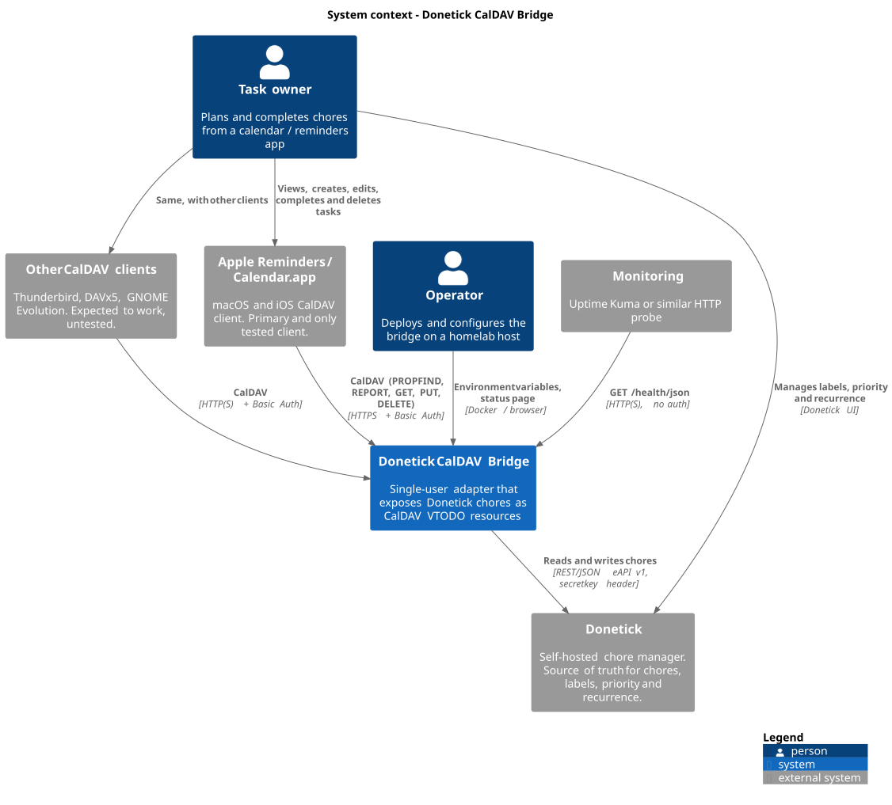
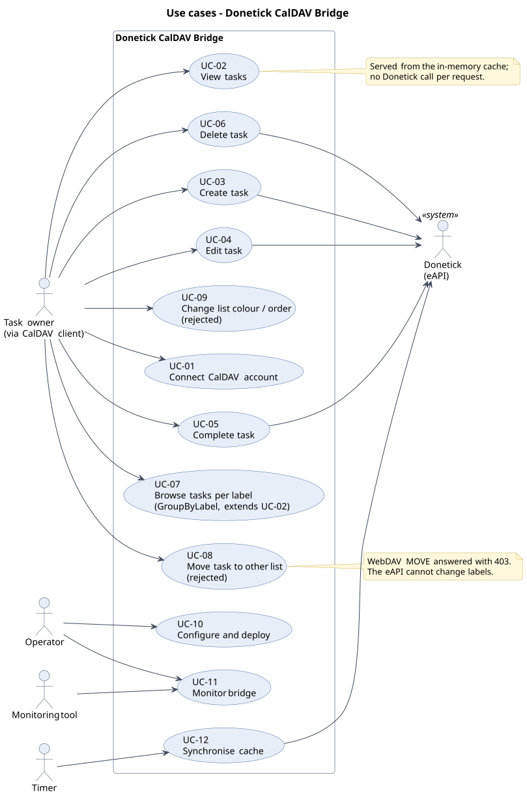
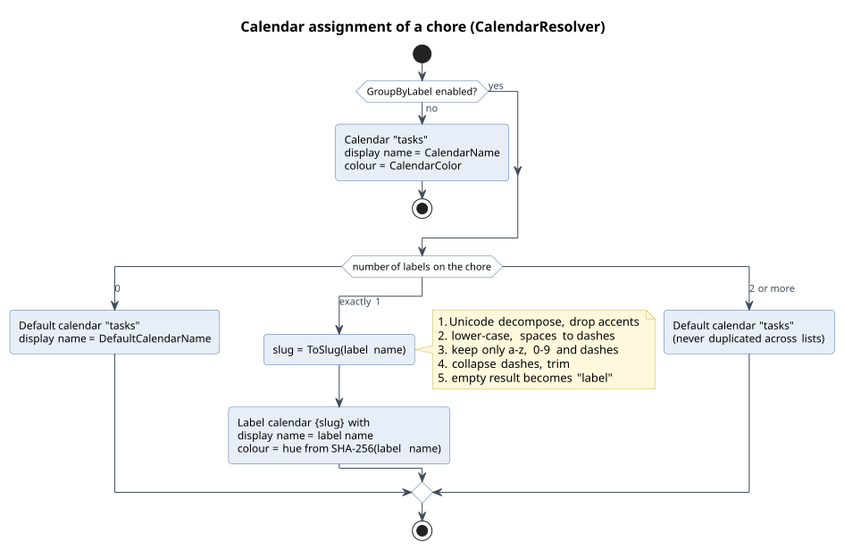

# Donetick CalDAV Bridge - Functional Design
Documented version: 0.7.1. Reverse engineered from the source code, tests, README, CHANGELOG and `instructions.md` on 2026-10-17.

## Summary
The Donetick CalDAV Bridge lets one Donetick user manage their chores from a CalDAV task client, primarily Apple Reminders and Calendar.app. Chores appear as to-do items (VTODO) in one task list, or in one list per label when `GroupByLabel` is enabled.

From the client the user can view tasks, create a task, change its title, notes and due date, complete it and delete it. Everything the Donetick external API cannot write (labels, priority, recurrence, assignee) stays under Donetick's control and is shown read-only.

Donetick is the single source of truth. The bridge keeps only an in-memory copy that is refreshed every 30 seconds by default, so changes made in Donetick reach the client after the next poll plus the client's own refresh interval.

The main functional constraints are:

- one user, one Donetick account, one set of CalDAV credentials
- the write path is limited to name, description, due date (date only), complete and delete
- lists per label are derived from Donetick and cannot be changed from the client (moving a task between lists is rejected)
- a few client actions are silently not carried over (clearing notes or the due date, un-completing, changing priority); see [Limitations](#11-limitations)

## 1 Introduction
### 1.1 Purpose
This document describes what the bridge does from the user's and operator's point of view: goals, actors, use cases, functional requirements, business rules, data mapping and non-functional requirements. How it is built is described in the [technical design](technical-design.md).

### 1.2 Method
The behaviour was derived from the code in `src/DonetickCalDav` and the unit tests in `tests/DonetickCalDav.Tests`. Statements that depend on Donetick or Apple behaviour and cannot be confirmed from this codebase are marked **Assumption**.

### 1.3 Related documents

| Document | Content |
|----------|---------|
| [technical-design.md](technical-design.md) | Architecture, components, protocols, caching, deployment |
| [findings.md](findings.md) | Defects, risks and improvement proposals from the reverse engineering |
| [../README.md](../README.md) | User guide and configuration reference |
| [../instructions.md](../instructions.md) | Rationale behind architectural decisions ("why") |
| [../CHANGELOG.md](../CHANGELOG.md) | Release history from 0.7.0 |

## 2 Background and goals
### 2.1 Problem
Donetick supports recurrence based on the completion date (a chore done late moves its next occurrence accordingly) and rewards completions with points. The owner, however, plans their day in the calendar and reminders apps and expects to stop using Donetick if it requires opening a separate app. The bridge brings Donetick chores into those apps without giving up Donetick's recurrence and points.

### 2.2 Goals

| ID | Goal |
|----|------|
| G1 | Donetick chores are visible in Apple Reminders, and those with a due date also in Calendar.app |
| G2 | Chores can be completed from the client, so Donetick's recurrence and points still apply |
| G3 | Basic task management from the client: create, rename, add notes, reschedule, delete |
| G4 | No additional data store; Donetick remains the single source of truth |
| G5 | Simple self-hosting as a Docker container (Docker Compose, Unraid) |

### 2.3 Non-goals
- Multiple users or multiple Donetick accounts
- A general-purpose CalDAV server (events, shared calendars, free/busy, scheduling)
- Editing labels, priority, recurrence or assignee from the client
- Running exposed to the public internet; the README recommends a private network such as Tailscale

## 3 Actors

| Actor | Type | Description |
|-------|------|-------------|
| Task owner | Person | The single Donetick user who works with tasks in a CalDAV client |
| Operator | Person | Deploys and configures the bridge; in practice usually the task owner |
| CalDAV client | Software | Apple Reminders, Calendar.app (macOS, iOS); other clients such as Thunderbird, DAVx5 or Evolution are expected to work but are untested |
| Donetick | External system | Chore manager; exposes the external API (eAPI) at `/eapi/v1/chore` |
| Monitoring tool | Software | Polls `/health/json`, for example Uptime Kuma |
| Timer | System | Triggers the periodic synchronisation |

## 4 System context
The bridge sits between the CalDAV clients and Donetick. Clients never talk to Donetick directly through the bridge; every read is answered from the bridge's cache, and every write is forwarded to Donetick.

Source: [diagrams/system-context.puml](diagrams/system-context.puml)

## 5 Use cases

Source: [diagrams/use-cases.puml](diagrams/use-cases.puml)

| ID | Use case | Primary actor | Writes to Donetick |
|----|----------|---------------|--------------------|
| UC-01 | Connect CalDAV account | Task owner | no |
| UC-02 | View tasks | Task owner | no |
| UC-03 | Create task | Task owner | yes |
| UC-04 | Edit task | Task owner | yes |
| UC-05 | Complete task | Task owner | yes |
| UC-06 | Delete task | Task owner | yes |
| UC-07 | Browse tasks per label (extends UC-02) | Task owner | no |
| UC-08 | Move task to another list (rejected) | Task owner | no |
| UC-09 | Change list colour, name or order (rejected) | Task owner | no |
| UC-10 | Configure and deploy | Operator | no |
| UC-11 | Monitor the bridge | Operator, monitoring tool | no |
| UC-12 | Synchronise cache | Timer | no (reads) |

### UC-01 Connect CalDAV account
**Precondition:** the bridge is running and reachable. For Apple clients it is reachable over HTTPS, because Apple Calendar and Reminders do not send Basic Auth credentials over plain HTTP (README).

**Main flow**
1. The task owner adds a CalDAV account in the client with the bridge URL, username and password.
2. The client discovers the service through `/.well-known/caldav` and is redirected to `/caldav/`. No credentials are needed for this step or for `OPTIONS`.
3. The client authenticates with HTTP Basic and discovers the principal and the calendar home.
4. The bridge returns the available task lists: one list, or a default list plus one list per label (UC-07).
5. The client loads the tasks of each list (UC-02).

**Alternative flows**
- Wrong credentials: the bridge answers 401 and the client asks for the password again.
- Donetick unreachable since startup: the lists exist but are empty until the first successful synchronisation.

**Postcondition:** the task lists appear in Reminders. On macOS the user must enable "Reminders" for the account; enabling "Calendars" as well makes tasks with a due date appear in Calendar.app.

### UC-02 View tasks
**Main flow**
1. The client periodically asks for the change tag of each list.
2. If the tag changed, the client asks which tasks changed (per-task ETag) and fetches only those.
3. Each task shows title, notes, due date (with or without time, see BR-07), priority, status and, in clients that support it, the labels as categories.

**Rules:** BR-04, BR-06 to BR-11, BR-15.

**Freshness:** a change made in Donetick becomes visible after at most `PollIntervalSeconds` (default 30 s) plus the client's own refresh interval. Changes made through the bridge are visible immediately, because the bridge updates its cache after each write.

### UC-03 Create task
**Main flow**
1. The task owner creates a new reminder in a list.
2. The client sends the new task under a client-generated identifier.
3. The bridge creates a chore in Donetick with the title, the notes (if any) and the due date (date part only, if any).
4. The bridge confirms with the canonical address `donetick-{id}.ics` and remembers the client identifier for follow-up requests until the next restart.

**Alternative flows**
- Created in a label list (GroupByLabel): the eAPI cannot set labels, so the chore is created without a label. After the next refresh it appears in the default list (BR-13).
- The new task already carries status COMPLETED and is unknown to the bridge: it is ignored and nothing is created (BR-14).
- Donetick returns an error or an empty response: the client receives 502 and shows a sync error.

**Postcondition:** the chore exists in Donetick and is shown in the default list.

### UC-04 Edit task
**Main flow**
1. The task owner changes the title, notes or due date of a task.
2. The bridge sends the title, notes and due date (date part only) to Donetick.
3. The bridge updates the task in its cache and confirms with the new ETag.

**Not carried over** (silently ignored): priority, flags, tags or categories, status other than COMPLETED, recurrence rules, alarms, location, URL, sub-tasks, and the time of day of the due date.

**Partly carried over:** clearing the notes or removing the due date in the client leaves the field out of the request. **Assumption:** Donetick keeps the previous value for omitted fields, so the old notes or due date return after the next refresh.

### UC-05 Complete task
**Main flow**
1. The task owner ticks off a task.
2. The bridge asks Donetick to complete the chore. Donetick records the completion (points, history) and, for a recurring chore, moves the next due date.
3. Because Donetick changes the chore in ways the bridge cannot predict, the bridge reloads all chores from Donetick.
4. The bridge confirms without an ETag, which makes the client fetch the task again. A recurring task reappears with its next due date and status "needs action".

**Alternative flows**
- Apple Reminders sends an extra completed copy of a recurring task under a new identifier. The bridge recognises it as a completed, unknown task and ignores it (BR-14), so no duplicate chore is created.
- With `PreserveScheduledTime` enabled, the next due date is shown at the originally scheduled time instead of the completion time (BR-08).
- **Assumption:** for a non-recurring chore the client shows whatever Donetick returns after completion; this codebase does not define it.

**Exception:** if Donetick accepts the completion but the reload that follows fails, the client receives an error even though the completion was registered. A retry by the client can then complete the chore a second time (see [findings.md](findings.md), F-01).

### UC-06 Delete task
**Main flow:** the task owner deletes a task; the bridge deletes the chore in Donetick and removes it from the cache.

**Rules:** deletion is permanent in Donetick (BR-16). Tasks can also be deleted through the client identifier remembered at creation (UC-03).

### UC-07 Browse tasks per label
**Precondition:** `GroupByLabel=true`.

**Main flow:** the client shows a default list (named `DefaultCalendarName`, default "General") and one list per label that is the only label of at least one chore. Each chore appears in exactly one list (BR-01). Lists are ordered with the default list first, then by slug alphabetically.

**Behaviour over time:** a label list appears as soon as one chore has that label as its only label, and disappears when no chore qualifies any more.

Source: [diagrams/act-calendar-assignment.puml](diagrams/act-calendar-assignment.puml)

### UC-08 Move task to another list (rejected)
Dragging a task to another list makes Apple Reminders send a WebDAV MOVE. The bridge answers 403 because the eAPI cannot change labels; the client shows an error and the task stays where it was. Labels are managed in Donetick.

If a client implements a move as delete plus create instead, the chore is deleted in Donetick and recreated as a new chore without labels, recurrence or priority (README, Group by Label section).

### UC-09 Change list colour, name or order (rejected)
Clients may try to store list properties such as colour or order. The bridge accepts the request but reports every property as not modifiable; nothing is stored. Name and colour of the default list come from configuration, those of label lists from the label.

### UC-10 Configure and deploy
The operator sets environment variables (section 9) and starts the container. The bridge validates the configuration at startup and refuses to start when a required value is missing or invalid, or when TLS is configured without a certificate. See the technical design, chapter 15, for deployment options.

### UC-11 Monitor the bridge
- **Status page** (`/` or `/health`, HTML): version, uptime, protocol, port, poll interval, number of chores (total, active, recurring, with due date), clients seen in the last hour (name, active if seen in the last 5 minutes, request count, last seen), total requests, Donetick URL, CalDAV username and calendar name.
- **Health endpoint** (`/health/json`): status, version, uptime, chore counts, Donetick URL and poll interval. HTTP 200 when the cache holds at least one chore, otherwise 503.

Both endpoints are available without authentication.

### UC-12 Synchronise cache
After startup the bridge loads all chores from Donetick, retrying up to three times. It then reloads all chores every `PollIntervalSeconds`. When Donetick is unreachable the previous data stays available and the next cycle tries again. The list change tag only changes when a chore was added, changed or removed.

## 6 Functional requirements
The requirements below describe the implemented behaviour.

| ID | Requirement | Implemented in |
|----|-------------|----------------|
| FR-01 | Answer `/.well-known/caldav` with a redirect to `/caldav/`, without authentication | `WellKnownHandler` |
| FR-02 | Answer `OPTIONS` on `/caldav` paths without authentication, advertising DAV classes `1, 3, access-control, calendar-access` and the allowed methods | `OptionsHandler`, `CalDavMiddleware` |
| FR-03 | Require HTTP Basic authentication against one configured username and password for all other `/caldav` requests | `CalDavAuthenticationHandler` |
| FR-04 | Expose one service root, one principal and one calendar home for the configured user | `PropFindHandler` |
| FR-05 | Always expose a default task list with slug `tasks` | `CalendarResolver` |
| FR-06 | With `GroupByLabel`, expose one additional list per label that is the only label of at least one chore | `CalendarResolver` |
| FR-07 | Declare VTODO as the only supported component of every list | `PropFindHandler` |
| FR-08 | Provide a change tag per list and an ETag per task | `ChoreCache`, `CalendarResolver` |
| FR-09 | Return tasks through PROPFIND (depth 1), REPORT `calendar-query`, `calendar-multiget` and `sync-collection`, and GET | `PropFindHandler`, `ReportHandler`, `GetHandler` |
| FR-10 | Answer a GET with matching `If-None-Match` with 304 | `GetHandler` |
| FR-11 | Create a chore on PUT of an unknown task that is not COMPLETED; answer 201 with the canonical `Location` and an ETag | `PutHandler` |
| FR-12 | Update name, description and due date on PUT of a known task | `PutHandler` |
| FR-13 | Complete the chore on PUT of a known task with status COMPLETED, then reload all chores | `PutHandler` |
| FR-14 | Ignore a PUT of an unknown task with status COMPLETED (204, nothing created) | `PutHandler` |
| FR-15 | Delete the chore on DELETE | `DeleteHandler` |
| FR-16 | Resolve a task by canonical file name, by the bridge's own UID, or by the client UID recorded at creation | `PathHelper`, `PutHandler`, `ChoreCache` |
| FR-17 | Reject MOVE, MKCALENDAR and MKCOL with 403 and other unknown methods with 405, both with an `Allow` header | `CalDavMiddleware` |
| FR-18 | Accept PROPPATCH but apply no change (207 with 404 per property) | `PropPatchHandler` |
| FR-19 | Reject PUT bodies over 1 MB (413) and bodies without a parseable VTODO (400) | `PutHandler` |
| FR-20 | Load all chores at startup with retries, then periodically | `ChoreSyncService` |
| FR-21 | Serve an HTML status page and a JSON health endpoint without authentication | `StatusPageHandler` |
| FR-22 | Serve HTTPS when a PEM or PFX certificate is configured | `Program.cs` |
| FR-23 | Validate configuration at startup and refuse to start when it is invalid | `AppSettings`, `Program.cs` |
| FR-24 | Optionally present due dates as all-day (date only) | `VTodoMapper` |
| FR-25 | Optionally replace the time of the due date with the scheduled time from Donetick | `VTodoMapper` |
| FR-26 | Report Donetick errors on the write path to the client as 502 | `PutHandler`, `DeleteHandler` |

## 7 Business rules
### BR-01 List assignment
Applies when `GroupByLabel=true`. A chore with exactly one label goes to that label's list. A chore with no labels or with two or more labels goes to the default list. A chore never appears in more than one list, because Apple would treat copies as separate tasks that each need to be completed.

### BR-02 List identifiers (slugs)
The list address is derived from the label name: accents removed, lower case, spaces replaced by dashes, all characters except `a-z`, `0-9` and `-` removed, repeated dashes collapsed and leading or trailing dashes trimmed. An empty result becomes `label`. Examples: "Private tasks" becomes `private-tasks`, "Werk & Leven" becomes `werk-leven`. Different labels that produce the same slug share one list. The slug `tasks` is reserved for the default list; a label that produces `tasks` merges into the default list.

### BR-03 List colours
The single list (GroupByLabel off) and the default list use `CalendarColor`. A label list gets a colour derived from the label name: a hue from a SHA-256 hash, with 55 % saturation and 50 % lightness. The same label always gets the same colour.

### BR-04 Status shown in the client

| Donetick | VTODO STATUS |
|----------|--------------|
| `isActive = false` (any status) | CANCELLED |
| status 1 In progress | IN-PROCESS (with PERCENT-COMPLETE 50) |
| status 3 Pending approval | IN-PROCESS |
| status 0 No status | NEEDS-ACTION |
| status 2 Paused | NEEDS-ACTION (iCalendar has no paused state) |

### BR-05 Status set in the client
Only COMPLETED has an effect: it completes the chore in Donetick. NEEDS-ACTION, IN-PROCESS and CANCELLED are not sent to Donetick. Un-completing a task in the client therefore does not undo a completion.

### BR-06 Priority shown in the client
Priority is shown, not written back.

| Donetick priority | iCalendar PRIORITY |
|-------------------|--------------------|
| 0 None | 0 (undefined) |
| 1 Low | 9 |
| 2 Medium | 5 |
| 3 High | 3 |
| 4 Urgent | 1 |

### BR-07 Due date presentation
- No due date in Donetick: no DUE and no DTSTART.
- Default: DUE carries date and time in UTC; DTSTART is the same date at 00:00 UTC.
- `AllDayEvents=true`: DUE and DTSTART carry only the date. Calendar.app shows the task as an all-day item; Reminders shows "today" instead of "today at 10:00". This applies to all tasks, because the eAPI does not expose a per-task preference.

### BR-08 Preserve scheduled time
With `PreserveScheduledTime=true`, the time of the due date is replaced by `frequencyMetadata.time` (HH:mm) from Donetick. When `frequencyMetadata.timezone` is a known time zone, the replacement happens in that zone and is converted back to UTC, which keeps the time correct across daylight saving changes. Without a time zone, or with an unknown one, the time is replaced in UTC. Chores without a parseable scheduled time are unchanged. Current Donetick versions store the scheduled time as a full timestamp, which the bridge cannot parse, so the rule has no effect with their data (finding F-23).

The rule is keyed on the presence of a scheduled time, not on the chore being recurring. The option has no visible effect together with `AllDayEvents`.

### BR-09 Recurrence
The bridge never sends a recurrence rule (RRULE). Recurrence is visible only as the next due date, which Donetick moves after each completion. A recurrence rule set in the client is ignored.

### BR-10 Labels
Labels are sent as `CATEGORIES` and as `X-APPLE-HASHTAGS`. Non-Apple clients such as Thunderbird, DAVx5 and Tasks.org show them as tags; Apple Reminders ignores both for CalDAV accounts, which is why BR-01 exists.

### BR-11 Progress
A chore with status In progress is shown with PERCENT-COMPLETE 50. No other progress values are produced or read.

### BR-12 Write payload
On create and update the bridge sends:
- `name`: the task title, or "Untitled Task" when the task has no title
- `description`: the notes, left out when empty or whitespace
- `dueDate`: the due date as `yyyy-MM-dd`, left out when the task has no due date

### BR-13 New tasks land in the default list
Because the eAPI cannot set labels, a task created in a label list is created without a label and moves to the default list after the next refresh. The README advises creating labelled tasks in Donetick.

### BR-14 Completed copies are ignored
A PUT for a task the bridge does not know, with status COMPLETED, creates nothing and is answered with 204. This handles the extra copy Apple Reminders sends when a recurring task is completed. A side effect is that a task created in an already completed state is never stored in Donetick.

### BR-15 Inactive chores remain visible
Chores that Donetick returns with `isActive = false` are not hidden; they are shown with status CANCELLED.

### BR-16 Deletion is permanent
Deleting a task in the client deletes the chore in Donetick. There is no undo in the bridge.

### BR-17 Forced refresh after completion
After a completion the bridge returns no ETag, so the client cannot treat its local completed copy as current and fetches the server state again.

## 8 Information model and field mapping
The Donetick chore is the only business entity. A task list is a view derived from the chores and has no storage of its own. The full data model is shown in the [technical design](technical-design.md#5-data-model).

| VTODO property | Read: source in Donetick | Write: sent to Donetick |
|----------------|--------------------------|-------------------------|
| `UID` | `donetick-{id}@donetick` | used to resolve the chore |
| `SUMMARY` | `name` | `name` ("Untitled Task" when the task has no title) |
| `DESCRIPTION` | `description` (empty when absent) | `description`, left out when empty |
| `DUE` | `nextDueDate` (BR-07, BR-08) | `dueDate`, date part only, left out when absent |
| `DTSTART` | derived from `nextDueDate` | no |
| `STATUS` | `status` and `isActive` (BR-04) | only COMPLETED, as a completion (BR-05) |
| `PRIORITY` | `priority` (BR-06) | no |
| `PERCENT-COMPLETE` | 50 when In progress | no |
| `CATEGORIES` | `labelsV2[].name` | no |
| `X-APPLE-HASHTAGS` | `labelsV2[].name`, comma separated | no |
| `CREATED` | `createdAt` | no |
| `LAST-MODIFIED`, `DTSTAMP` | `updatedAt` | no |
| `RRULE` | never sent | ignored |
| `VALARM` and other properties | not produced | ignored |

Donetick fields that are read but not shown: `frequencyType`, `frequency`, `isRolling`, `assignedTo`, `createdBy`, `circleId`, `completionWindow`, `deadlineOffset`, `projectId`. `frequencyMetadata` is used only for BR-08; `frequencyType` is used only for the "recurring" count on the status page.

## 9 Configuration
Settings are read from environment variables, where a double underscore separates the section (`CalDav__GroupByLabel`). Defaults below are those of the bundled `appsettings.json`.

| Setting | Default | Validation | Functional effect |
|---------|---------|------------|-------------------|
| `Donetick__BaseUrl` | `http://localhost:8080` | required, valid URL | Donetick instance to use |
| `Donetick__ApiKey` | empty | required | eAPI key, sent as `secretkey` header |
| `Donetick__PollIntervalSeconds` | 30 | 5 to 3600 | Maximum delay before Donetick changes reach the bridge |
| `CalDav__Username` | `user` | required | CalDAV login name, also part of every URL |
| `CalDav__Password` | `pass` | required | CalDAV password |
| `CalDav__CalendarName` | `DonetickTasks` | none | Name of the single list (GroupByLabel off) |
| `CalDav__CalendarColor` | `#4A90D9FF` | none | Colour of the single or default list (RRGGBBAA) |
| `CalDav__GroupByLabel` | false | none | One list per label (UC-07, BR-01) |
| `CalDav__DefaultCalendarName` | `General` | none | Name of the default list when GroupByLabel is on |
| `CalDav__AllDayEvents` | false | none | Due dates without time (BR-07) |
| `CalDav__PreserveScheduledTime` | false | none | Scheduled time instead of completion time (BR-08) |
| `CalDav__ListenPort` | 5232 | 1 to 65535 | TCP port |
| `CalDav__Tls__CertPath`, `CalDav__Tls__KeyPath` | none | both or PFX required when TLS section present | HTTPS with PEM certificate and key |
| `CalDav__Tls__PfxPath`, `CalDav__Tls__PfxPassword` | none | see above | HTTPS with PFX certificate |
| `Logging__LogLevel__DonetickCalDav` | `Information` | none | `Debug` adds protocol-level logging |

The defaults `user` and `pass` pass validation. Operators must override them; nothing in the code enforces this.

## 10 Non-functional requirements

| ID | Category | Requirement | How it is met |
|----|----------|-------------|---------------|
| NFR-01 | Security | Only the configured user can read or change tasks | HTTP Basic on all CalDAV requests except discovery and OPTIONS; constant-time credential comparison |
| NFR-02 | Security | Credentials are not sent in clear text to Apple clients | HTTPS via built-in TLS, Tailscale serve or a reverse proxy; Apple refuses Basic Auth over HTTP |
| NFR-03 | Security | The bridge is not exposed to the internet | Deployment guidance (README); not enforced by the software |
| NFR-04 | Availability | Tasks remain readable when Donetick is temporarily down | Reads come from the cache; failed polls keep the previous data |
| NFR-05 | Availability | Short Donetick outages do not fail writes | Three retries after 5, 15 and 40 seconds on connection errors and 5xx, within roughly 60 seconds |
| NFR-06 | Consistency | Donetick changes reach clients within a bounded time | Polling every 5 to 3600 seconds (default 30); writes update the cache immediately |
| NFR-07 | Performance | Reads do not depend on Donetick latency | All reads are served from memory |
| NFR-08 | Compatibility | Works with Apple Reminders and Calendar.app on macOS and iOS | Discovery and PROPFIND responses follow Apple's flow; the only clients tested |
| NFR-09 | Compatibility | Standards based | Subset of WebDAV (RFC 4918), CalDAV (RFC 4791), discovery (RFC 6764) and iCalendar (RFC 5545) |
| NFR-10 | Capacity | One user with a handful of devices | Single principal; client tracking capped at 100 entries |
| NFR-11 | Robustness | Malformed or oversized input does not affect the service | 1 MB limit on PUT; parse errors give 400; unknown Donetick response shapes are logged as errors instead of emptying the lists |
| NFR-12 | Operability | Misconfiguration is detected at startup | Options validation on startup; TLS without certificate aborts startup |
| NFR-13 | Operability | Health can be monitored | JSON health endpoint, HTML status page, structured logs |
| NFR-14 | Data | No data is stored outside Donetick | In-memory cache only; a restart rebuilds it |
| NFR-15 | Maintainability | Mapping logic is protected by tests | About 160 unit tests, concentrated on mapping, cache and handlers |
| NFR-16 | Portability | Runs as a container | Multi-stage Dockerfile on .NET 10, Docker Compose example, Unraid template |

## 11 Limitations
The limitations below follow from what the Donetick eAPI supports, from how Apple clients use CalDAV, or from deliberate design choices. Known defects and improvement proposals are kept in [findings.md](findings.md).

| ID | Limitation | Effect for the user |
|----|------------|---------------------|
| L-01 | Single user | All clients share the same task lists |
| L-02 | Labels, priority and recurrence cannot be changed from the client | Changes made in the client revert after the next refresh; manage them in Donetick |
| L-03 | New tasks always land in the default list (BR-13) | A task created in a label list moves to the default list after refresh |
| L-04 | Moving a task between lists is rejected (UC-08) | The client shows an error and the task stays in place |
| L-05 | Apple Reminders ignores categories and hashtags on CalDAV accounts (BR-10) | In Apple clients, labels are visible only as separate lists (GroupByLabel) |
| L-06 | The client-UID mapping for newly created tasks is lost on restart | A follow-up request in the short window after creating a task may not find it |
| L-07 | Clearing notes or removing the due date in the client is not sent to Donetick | The old value returns after the next refresh (Donetick keeps omitted fields, contract check CT-04) |
| L-08 | Only the date of a due date set in the client is sent, not the time of day | The time shown afterwards is the time Donetick assigns: the current UTC time of day (contract check CT-02) |
| L-09 | Un-completing a task is not possible (BR-05) | The completion in Donetick stays |
| L-10 | A task created in an already completed state is not stored (BR-14) | The task disappears after refresh |
| L-11 | List properties set in the client are not stored (UC-09) | Client-side changes to list colour or order may revert |
| L-12 | A label list exists only while at least one chore has that label as its only label (UC-07) | The list disappears when its last chore is removed or relabelled |
| L-13 | Labels that produce the same slug share one list; a label whose slug is `tasks` merges into the default list (BR-02) | Unexpected grouping |

## 12 Glossary

| Term | Meaning |
|------|---------|
| Chore | A Donetick task; the only business entity |
| VTODO | iCalendar to-do component used to represent a chore over CalDAV |
| Task list, calendar | A CalDAV calendar collection; here always a view on chores |
| Default list | The list with slug `tasks`; holds all chores, or with GroupByLabel those with zero or several labels |
| Label list | A list derived from a Donetick label (GroupByLabel) |
| Slug | URL-safe form of a label name, used in the list address |
| CTag | Change tag of a list; changes when any task in it changes |
| ETag | Version tag of one task |
| eAPI | Donetick's external REST API at `/eapi/v1/chore`, authenticated with the `secretkey` header |
| UID map | In-memory link between a client-generated task identifier and the Donetick chore ID |
| Poll interval | Time between two full reloads of chores from Donetick |
