# Donetick CalDAV Bridge - Technical Design
Documented version: 0.7.1. Reverse engineered from the source code, tests, Dockerfile and project notes on 2026-10-17.

## Summary
The bridge is a single ASP.NET Core 10 process that implements a small, Apple-oriented subset of CalDAV on top of an in-memory cache of Donetick chores. One custom middleware routes every request; one scoped handler per HTTP method does the work; a background service refreshes the cache from the Donetick external API. There is no database and no persistent state.

The main technical characteristics are:

- **Read model in memory:** every read is answered from `ChoreCache`; every write goes synchronously to Donetick and is then reflected in the cache.
- **Change detection:** a deterministic ETag per chore and a CTag per list let clients skip unchanged data.
- **Virtual calendars:** with GroupByLabel, lists per label are computed on the fly from the cache; nothing is stored.
- **Resilience:** HTTP retries after 5, 15 and 40 seconds, a retrying startup load, and stale-but-available data when Donetick is down.
- **Security:** HTTP Basic with a constant-time comparison, HTTPS built in or terminated in front of the bridge.

Deliberate design choices are summarised in chapter 17. Defects, risks and improvement proposals found during the reverse engineering are kept separately in [findings.md](findings.md).

## 1 Introduction
### 1.1 Purpose and scope
This document describes how the bridge is built: architecture, components, data model, protocol handling, caching, integration with Donetick, security, deployment and testing. The functional behaviour is described in the [functional design](functional-design.md); the rationale behind deliberate choices is kept in [../instructions.md](../instructions.md).

### 1.2 Method and conventions
All statements are derived from the code under `src/DonetickCalDav`, the tests under `tests/DonetickCalDav.Tests`, `Dockerfile`, `docker-compose.yml.example` and `unraid-template.xml`. Behaviour of Donetick or Apple clients that cannot be confirmed from this repository is marked **Assumption**. Class names refer to files in `src/DonetickCalDav` unless a path is given.

Diagrams are written in PlantUML; sources live in [diagrams/](diagrams/) and rendered SVGs in [diagrams/svg/](diagrams/svg/).

## 2 Architecture overview
### 2.1 Style
The bridge is an **adapter**: it translates between two protocols and owns no business data.

- **Inbound:** WebDAV/CalDAV over HTTP(S), XML request and response bodies, iCalendar (VTODO) payloads.
- **Outbound:** Donetick eAPI v1, REST with JSON, authenticated with a `secretkey` header.
- **Inside:** a read model (`ChoreCache`) that is refreshed by polling and updated after each write. All reads are served from it; all writes go synchronously to Donetick first and are then reflected in the cache.

### 2.2 Architectural principles
These follow from the code and are made explicit in `instructions.md`:

| Principle | Consequence in the code |
|-----------|-------------------------|
| Donetick is the single source of truth | No persistence; restart rebuilds the cache with one GET |
| Serve only what Apple clients use | One principal, a minimal property set, no scheduling, no VEVENT |
| Let the server own recurrence | No RRULE in or out; refetch after completion |
| Fail loudly | Options validated at startup; unknown Donetick JSON shape throws |
| Single user, private network | HTTP Basic only, credentials from configuration |

### 2.3 Component view
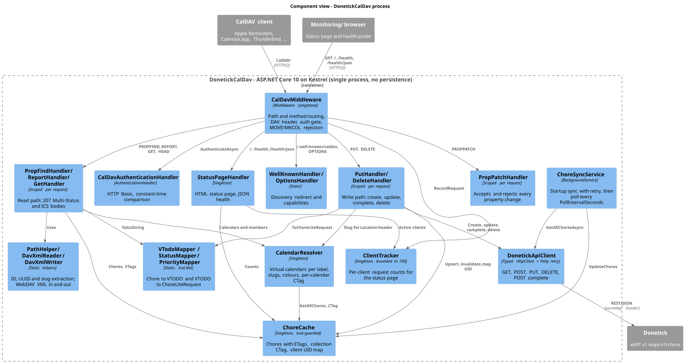

Source: [diagrams/components.puml](diagrams/components.puml)

| Component | Kind | Responsibility |
|-----------|------|----------------|
| `CalDavMiddleware` | Middleware | Routes on path and method, adds the `DAV` header, enforces authentication, rejects MOVE, MKCALENDAR and MKCOL |
| `CalDavAuthenticationHandler` | Authentication handler | Validates HTTP Basic credentials with a constant-time comparison |
| `WellKnownHandler`, `OptionsHandler` | Static | Discovery redirect, capability response |
| `PropFindHandler` | Scoped | PROPFIND on service root, principal, calendar home, collections and resources |
| `ReportHandler` | Scoped | REPORT `calendar-query`, `calendar-multiget`, `sync-collection` |
| `GetHandler` | Scoped | GET and HEAD of a single `.ics` resource, with `If-None-Match` |
| `PutHandler` | Scoped | Create, update and complete chores from VTODO bodies |
| `DeleteHandler` | Scoped | Delete chores |
| `PropPatchHandler` | Scoped | Accepts PROPPATCH and rejects every property |
| `StatusPageHandler` | Singleton | HTML status page and JSON health |
| `CalendarResolver` | Singleton | Virtual calendars (GroupByLabel), slugs, colours, per-calendar CTag |
| `PathHelper` | Static | Extracts chore ID, client UUID and calendar slug from paths |
| `DavXmlReader`, `DavXmlWriter`, `DavNamespaces` | Static and builder | Parse WebDAV request XML; build 207 Multi-Status responses |
| `VTodoMapper`, `StatusMapper`, `PriorityMapper` | Static | Chore to VTODO and VTODO to write request |
| `ChoreCache` | Singleton | Chores with ETags, collection CTag, client UID map |
| `ChoreSyncService` | Hosted service | Startup load with retries, periodic polling |
| `ClientTracker` | Singleton | Request statistics per client type |
| `DonetickApiClient` | Typed `HttpClient` | eAPI calls, wrapped by a Polly retry pipeline |

## 3 Technology stack

| Area | Choice | Version (csproj, resolved at last restore) |
|------|--------|--------------------------------------------|
| Runtime | .NET, `net10.0` | 10 (LTS) |
| Web host | ASP.NET Core minimal hosting, Kestrel | 10 |
| iCalendar | Ical.Net | 5.2.3 |
| HTTP resilience | Microsoft.Extensions.Http.Resilience (Polly v8) | 10.11.0 |
| JSON | System.Text.Json | framework |
| XML | System.Xml.Linq | framework |
| Tests | xUnit, xunit.runner.visualstudio, FluentAssertions, NSubstitute, Microsoft.NET.Test.Sdk | 2.9.3, 4.0.1, 7.2.2, 6.2.0, 18.11.0 |
| Container | `mcr.microsoft.com/dotnet/sdk:10.0` (build), `mcr.microsoft.com/dotnet/aspnet:10.0` (runtime) | 10.0 |

The application version is declared once, in `<Version>` of `DonetickCalDav.csproj`, and read at runtime from `AssemblyInformationalVersionAttribute`.

## 4 Source layout

```text
donetick_caldav/
  Dockerfile, docker-compose.yml.example, unraid-template.xml
  src/DonetickCalDav/
    Program.cs                    composition root, Kestrel, TLS, HttpClient + retry
    Configuration/AppSettings.cs  options classes and source-generated validator
    Donetick/                     eAPI client, interface and JSON models
    Cache/                        ChoreCache, ChoreSyncService, ClientTracker
    CalDav/
      Middleware/                 CalDavMiddleware, CalDavAuthenticationHandler
      Handlers/                   one handler per method, CalendarResolver, PathHelper, StatusPageHandler
      VTodo/                      VTodoMapper, StatusMapper, PriorityMapper
      Xml/                        DavXmlReader, DavXmlWriter, DavNamespaces
  tests/DonetickCalDav.Tests/     xUnit tests mirroring the source folders, plus Helpers/
  docs/                           this documentation
```

## 5 Data model
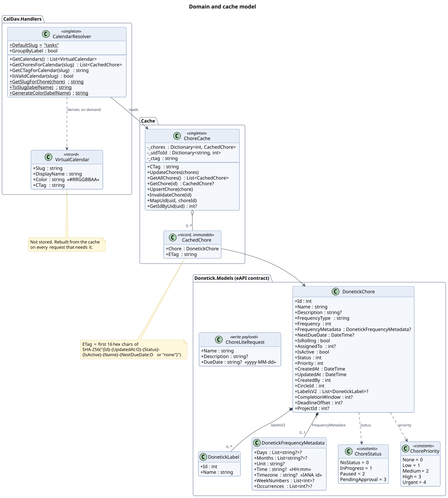

Source: [diagrams/domain-model.puml](diagrams/domain-model.puml)

### 5.1 Donetick models
`DonetickChore` mirrors the JSON of `GET /eapi/v1/chore` (property names via `[JsonPropertyName]`). Labels come from `labelsV2`. `DonetickFrequencyMetadata` varies by `frequencyType`; the bridge only uses `time` and `timezone`. `ChoreStatus` and `ChorePriority` are integer constants, not enums, matching the API.

`ChoreLiteRequest` is the only write payload. `description` and `dueDate` are omitted from the JSON when null (`JsonIgnoreCondition.WhenWritingNull`).

### 5.2 Cache model
`CachedChore` is an immutable record of a chore and its ETag. Immutability is relied on: `ChoreCache.GetAllChores()` returns the same record instances without copying.

`VirtualCalendar` (slug, display name, colour, CTag) is not stored; `CalendarResolver` derives it from the cache on each call.

### 5.3 Tags

| Tag | Scope | Computation | Changes when |
|-----|-------|-------------|--------------|
| ETag | One chore | First 16 hex characters of SHA-256 over `Id`, `UpdatedAt`, `Status`, `IsActive`, `Name`, `NextDueDate`, quoted | One of those fields changes |
| CTag, GroupByLabel off | Whole cache | New random GUID, quoted | Any chore added, changed (ETag differs) or removed; any upsert; any invalidation; process restart |
| CTag, GroupByLabel on | One virtual calendar | First 16 hex characters of SHA-256 over the member ETags sorted by chore ID; all-zero GUID when empty | Membership or a member ETag changes; stable across restarts |

The ETag is deterministic, so unchanged chores keep their ETag across polls and restarts. Description, labels, priority and frequency metadata are not part of it.

## 6 Startup and composition
### 6.1 Composition root
`Program.cs` builds the host in this order:

1. Read the version from the assembly.
2. Bind `AppSettings` from configuration (`appsettings.json`, environment variables) and register `AppSettingsValidator` with `ValidateOnStart()`.
3. Take a setup-time snapshot of the settings for Kestrel and `HttpClient` configuration.
4. Register the typed `HttpClient` for `IDonetickApiClient` with base address, `secretkey` header, 90 s timeout and the retry pipeline (chapter 13).
5. Register services (table below).
6. Register the `BasicAuth` authentication scheme, without calling `UseAuthentication()`; the middleware authenticates explicitly so that discovery and OPTIONS stay anonymous.
7. Raise the log level of `Microsoft.AspNetCore.Authentication`, `CalDavAuthenticationHandler` and `System.Net.Http.HttpClient` to Warning to suppress the 401 noise caused by Apple's credential-less first requests.
8. Configure Kestrel to listen on `ListenPort` on all interfaces, with HTTPS when a certificate is configured.
9. Add `CalDavMiddleware` as the only middleware and run.

### 6.2 Service registrations

| Lifetime | Types |
|----------|-------|
| Singleton | `ChoreCache`, `CalendarResolver`, `ClientTracker`, `StatusPageHandler` (factory, receives the version string) |
| Hosted service | `ChoreSyncService` |
| Scoped | `PropFindHandler`, `ReportHandler`, `GetHandler`, `PutHandler`, `DeleteHandler`, `PropPatchHandler` |
| Typed HTTP client | `IDonetickApiClient` implemented by `DonetickApiClient` (transient, from `IHttpClientFactory`) |
| Authentication | `CalDavAuthenticationHandler` under scheme `BasicAuth` |

`CalDavMiddleware` is constructed once; the scoped handlers are injected per request as parameters of `InvokeAsync`.

### 6.3 Configuration validation
`AppSettingsValidator` is a source-generated `[OptionsValidator]`. `[ValidateObjectMembers]` makes it recurse into `Donetick` and `CalDav`. Rules: `BaseUrl` required and a URL, `ApiKey`, `Username`, `Password` required and non-empty, `PollIntervalSeconds` 5 to 3600, `ListenPort` 1 to 65535. A violation aborts host startup.

Note that the bundled `appsettings.json` provides `user` and `pass`, so the credential rules only catch an explicitly emptied value.

### 6.4 TLS
`LoadCertificate` runs once when Kestrel is configured:

- no `CalDav:Tls` section: plain HTTP
- `PfxPath` set: `X509CertificateLoader.LoadPkcs12FromFile(PfxPath, PfxPassword)`
- `CertPath` and `KeyPath` set: `X509Certificate2.CreateFromPemFile`
- section present but neither option complete: `InvalidOperationException`, startup fails

## 7 Request pipeline and routing
### 7.1 Pipeline
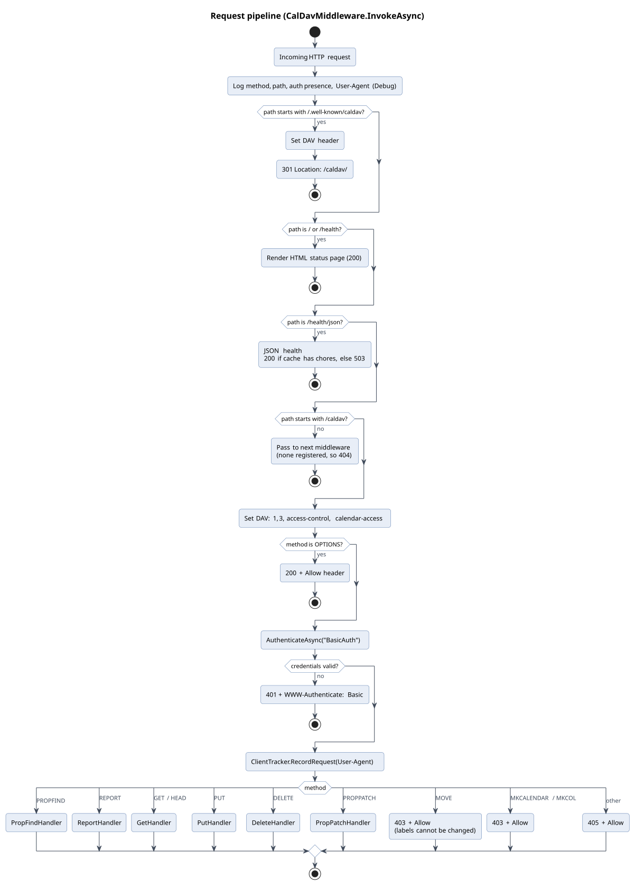

Source: [diagrams/act-request-pipeline.puml](diagrams/act-request-pipeline.puml)

### 7.2 Routing table

| Path | Method | Auth | Result |
|------|--------|------|--------|
| `/.well-known/caldav*` | any | no | 301 to `/caldav/`, `DAV` header |
| `/`, `/health` | any | no | HTML status page |
| `/health/json` | any | no | JSON health, 200 or 503 |
| `/caldav*` | OPTIONS | no | 200, `Allow`, `DAV` |
| `/caldav*` | PROPFIND | yes | `PropFindHandler` |
| `/caldav*` | REPORT | yes | `ReportHandler` |
| `/caldav*` | GET, HEAD | yes | `GetHandler` |
| `/caldav*` | PUT | yes | `PutHandler` |
| `/caldav*` | DELETE | yes | `DeleteHandler` |
| `/caldav*` | PROPPATCH | yes | `PropPatchHandler` |
| `/caldav*` | MOVE, MKCALENDAR, MKCOL | yes | 403, `Allow` |
| `/caldav*` | other | yes | 405, `Allow` |
| anything else | any | no | end of pipeline, 404 |

### 7.3 Common headers

| Header | When |
|--------|------|
| `DAV: 1, 3, access-control, calendar-access` | Every `/caldav` response including 401, and `.well-known` |
| `Allow: OPTIONS, GET, HEAD, PUT, DELETE, PROPFIND, PROPPATCH, REPORT` | OPTIONS, 403, 405 |
| `WWW-Authenticate: Basic realm="DonetickCalDAV"` | 401 |
| `ETag` | GET 200 and 304, PUT create, PUT update; deliberately absent after PUT complete |
| `Location` | PUT create (201), canonical `/caldav/calendars/{user}/{slug}/donetick-{id}.ics` |

### 7.4 Status codes

| Code | Meaning in this service |
|------|-------------------------|
| 200 | GET resource, OPTIONS, status pages |
| 201 | PUT created a chore |
| 204 | PUT update, complete or ignored completed copy; DELETE |
| 207 | PROPFIND, REPORT, PROPPATCH |
| 301 | `.well-known` redirect |
| 304 | GET with matching `If-None-Match` |
| 400 | PUT without parseable VTODO; REPORT without parseable body |
| 401 | Missing or invalid credentials |
| 403 | MOVE, MKCALENDAR, MKCOL |
| 404 | Unknown path, chore or calendar |
| 405 | Other methods under `/caldav` |
| 413 | PUT body over 1 MB |
| 501 | REPORT of an unsupported type |
| 502 | Donetick error on the write path, or empty create response |
| 503 | `/health/json` with an empty cache |

## 8 CalDAV protocol implementation
### 8.1 URL namespace
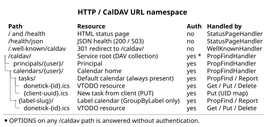

Source: [diagrams/url-namespace.puml](diagrams/url-namespace.puml)

`{user}` is `CalDav:Username`; the comparison is case-insensitive. Trailing slashes are trimmed before matching. With GroupByLabel off, `tasks` is the only valid calendar slug.

### 8.2 Discovery and initial load
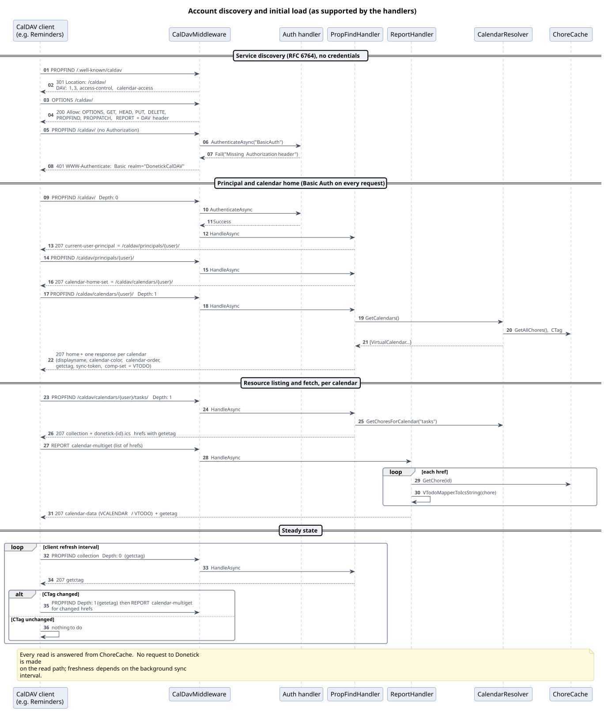

Source: [diagrams/seq-discovery.puml](diagrams/seq-discovery.puml)

### 8.3 PROPFIND
`PropFindHandler` reads the requested property names from the body (`DAV:prop` children). Each property is resolved to a value or listed under a 404 propstat. An empty or missing body yields an empty request list; for the service root and principal a small default set is returned in that case.

| Level | Path | Properties answered | Depth 1 |
|-------|------|---------------------|---------|
| Service root | `/caldav/` | `current-user-principal`, `principal-URL`, `resourcetype` (collection) | no |
| Principal | `/caldav/principals/{user}/` | `calendar-home-set`, `current-user-principal`, `principal-URL`, `resourcetype` (collection, principal), `displayname`, `supported-report-set` | no |
| Calendar home | `/caldav/calendars/{user}/` | `resourcetype`, `displayname` ("{user} Calendars"), `current-user-principal` | adds one response per virtual calendar with the collection properties below |
| Collection | `/caldav/calendars/{user}/{slug}/` | `resourcetype` (collection, calendar), `displayname`, `supported-calendar-component-set` (VTODO), `CS:getctag`, `sync-token` (`http://donetick-caldav/sync/{ctag}`), `current-user-privilege-set` (read, write, read-current-user-privilege-set), `apple:calendar-color`, `apple:calendar-order`, `calendar-description` ("Tasks from Donetick"), `supported-report-set`, `current-user-principal`, `owner` | adds one response per chore with the resource properties |
| Resource | `.../donetick-{id}.ics` | `getetag`, `getcontenttype` (`text/calendar; component=vtodo`), `calendar-data`, `resourcetype` (empty) | n/a |

`supported-report-set` lists `calendar-query` and `calendar-multiget` only. `calendar-order` is the 1-based position in the calendar list (default calendar first).

### 8.4 REPORT

| Report | Behaviour |
|--------|-----------|
| `calendar-query` | Returns every chore of the calendar identified by the URL slug. Filters in the request (time range, component, status) are ignored. |
| `calendar-multiget` | Returns the requested hrefs. Collection hrefs are skipped; hrefs without `donetick-{id}.ics` are skipped; unknown IDs get a response whose requested properties are all 404. |
| `sync-collection` | Returns every chore of the calendar plus a `sync-token` equal to the calendar CTag. The client's token is not evaluated and removed members are never reported. |
| other | 501 |

An empty or unparseable body gives 400.

### 8.5 GET and HEAD
The chore ID is resolved from `donetick-{id}.ics` or, failing that, from a client UUID file name through the UID map. With a matching `If-None-Match` the handler returns 304 with the ETag; otherwise 200, `text/calendar; charset=utf-8`, the ETag and the serialised VCALENDAR. HEAD uses the same code; Kestrel suppresses the body.

### 8.6 PUT, DELETE
See chapter 10.

### 8.7 PROPPATCH
All property names under `DAV:set` and `DAV:remove` are collected and returned in a single 404 propstat for the request path. An empty body returns a bare 207 without a body.

### 8.8 Unsupported operations
MOVE, MKCALENDAR and MKCOL return 403 with `Allow`. MOVE is logged at Information because it is a user action (dragging between lists). COPY, LOCK, UNLOCK, ACL and other methods return 405. There is no support for scheduling (RFC 6638), VEVENT, free-busy, ACL changes or WebDAV locking.

## 9 Caching and synchronisation
### 9.1 ChoreCache
`ChoreCache` holds three fields guarded by one `lock`:

- `_chores`: `Dictionary<int, CachedChore>`
- `_uidToId`: `Dictionary<string, int>` (client UID to chore ID)
- `_ctag`: the global collection tag

| Operation | Behaviour | CTag |
|-----------|-----------|------|
| `UpdateChores(list)` | Builds a new dictionary; keeps the existing record when the ETag is unchanged; detects removed IDs; swaps the dictionary | New only when something was added, changed or removed |
| `UpsertChore(chore)` | Replaces one entry with a fresh ETag | Always new |
| `InvalidateChore(id)` | Removes one entry | New when the entry existed |
| `GetAllChores()` | Copy of the value list (same immutable records) | none |
| `GetChore(id)` | Single entry or null | none |
| `MapUid(uid, id)`, `GetIdByUid(uid)` | UID map write and read | none |

Readers never see a partially updated dictionary because `UpdateChores` swaps a fully built instance under the lock. The UID map is never pruned and is lost on restart, by design (`instructions.md`, "UID mapping is ephemeral").

### 9.2 ChoreSyncService
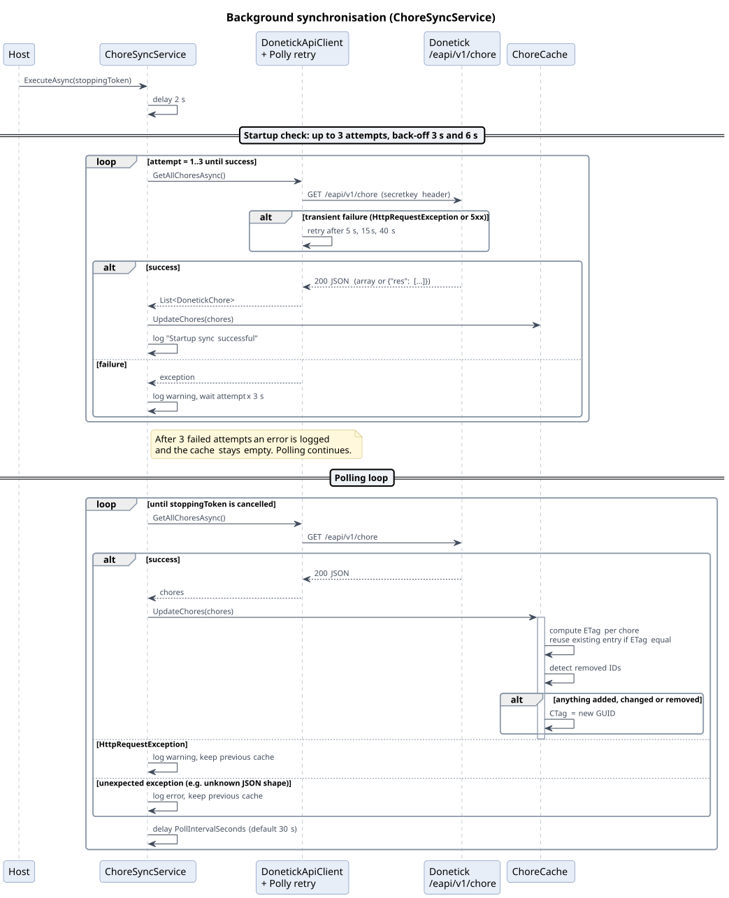

Source: [diagrams/seq-sync.puml](diagrams/seq-sync.puml)

- Waits 2 s after start.
- Startup check: up to three attempts of `GetAllChoresAsync`, with 3 s and 6 s between attempts. Each attempt includes the HTTP-level retries of chapter 13, so a fully failing startup check can take several minutes. After three failures an error is logged and polling starts with an empty cache.
- Polling loop: `GetAllChoresAsync`, `UpdateChores`, wait `PollIntervalSeconds`. The first loop iteration runs immediately after the startup check. `HttpRequestException` is logged as a warning and other exceptions as errors; in both cases the previous cache is kept. Cancellation on shutdown ends the loop silently.

### 9.3 Consistency model
- Reads are eventually consistent with Donetick: staleness is bounded by the poll interval plus the time a request takes.
- Writes through the bridge are read-your-writes: create and update upsert the returned chore, delete invalidates it, complete reloads everything.
- There is no optimistic concurrency. The bridge does not evaluate `If-Match` or `If-None-Match` on PUT or DELETE, and the eAPI offers no version check, so concurrent edits in Donetick and in a client resolve as last writer wins.

## 10 Write path
### 10.1 PUT decision logic
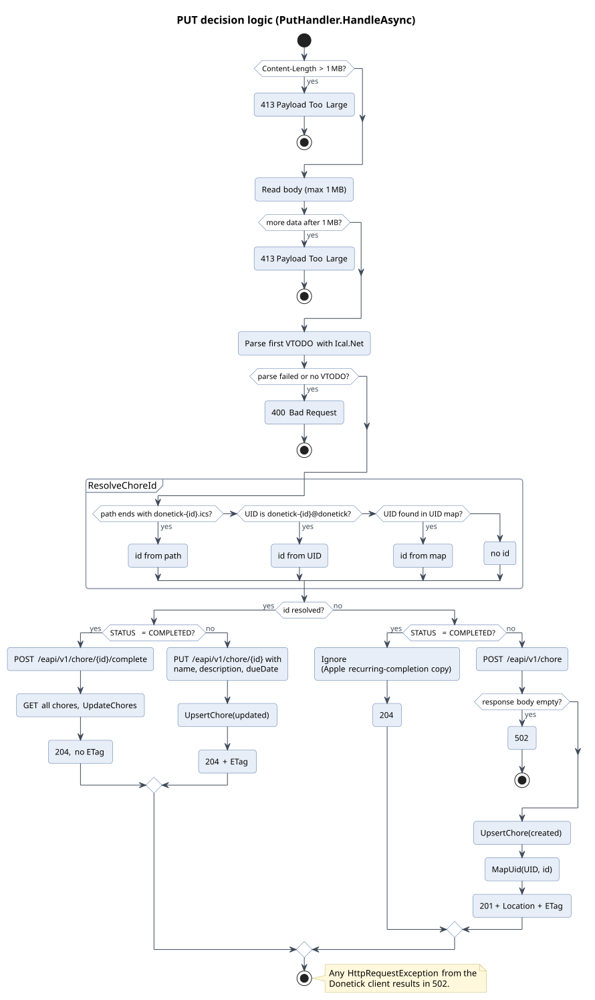

Source: [diagrams/act-put-routing.puml](diagrams/act-put-routing.puml)

Details:

- **Body limit:** `Content-Length` over 1,048,576 is rejected before reading. The body is then read into a 1,048,576-character buffer with `ReadBlockAsync`; if the buffer is full and more data follows, 413. The second check counts characters, not bytes.
- **Parsing:** `Calendar.Load` from Ical.Net; the first VTODO is used. Every exception except `OperationCanceledException` is caught and turned into 400. Ical.Net does not document its exception surface; in practice the parser throws `SerializationException` on malformed lines and `Calendar.Load` throws `InvalidOperationException` when a body holds several VCALENDARs.
- **ID resolution:** path pattern `donetick-(\d+)\.ics$`, then UID `donetick-{id}@donetick`, then the UID map. The UUID file name in the path is not consulted by PUT; the UID inside the body is.
- **Error mapping:** `HttpRequestException` from the Donetick client gives 502. Other exceptions are not caught by the handler and result in a 500 from the host.

### 10.2 Create
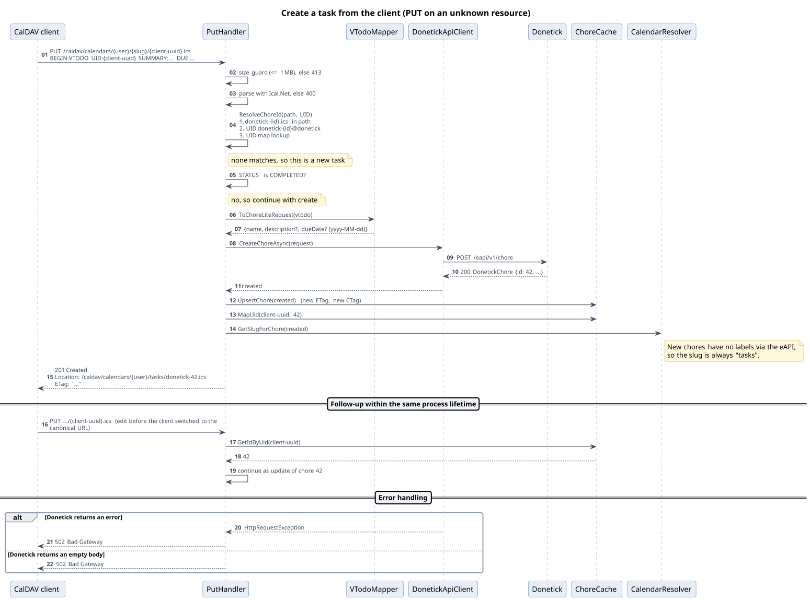

Source: [diagrams/seq-create.puml](diagrams/seq-create.puml)

### 10.3 Complete
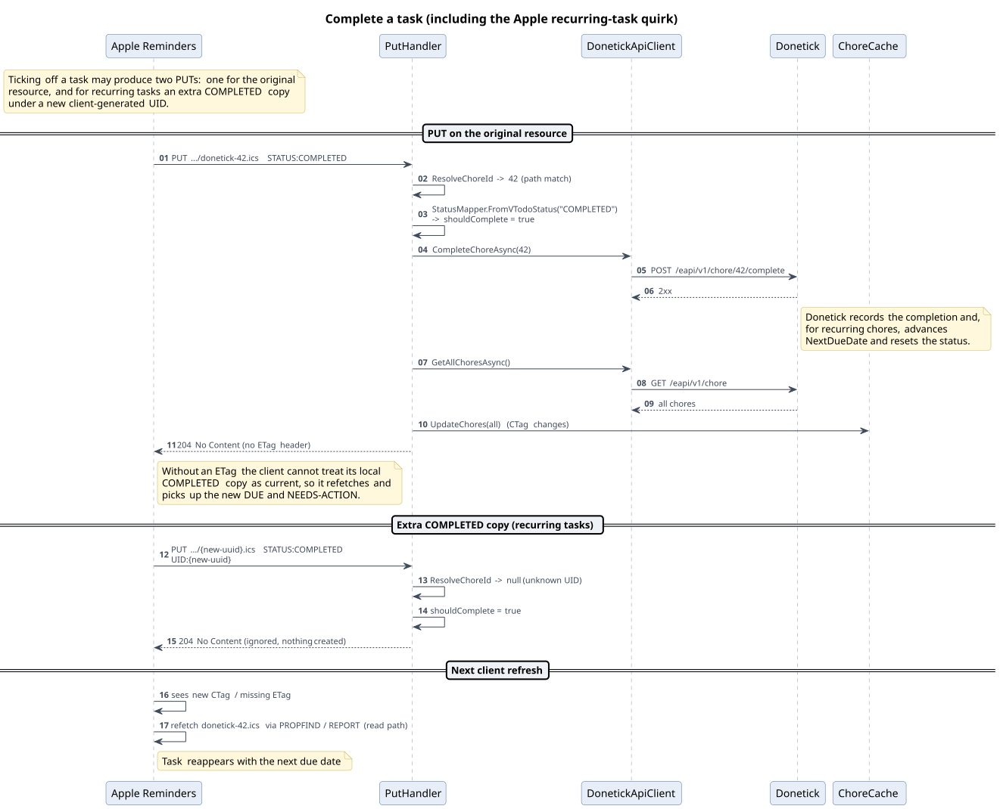

Source: [diagrams/seq-complete.puml](diagrams/seq-complete.puml)

The full reload after completion is deliberate: Donetick changes `nextDueDate` and status in ways the bridge cannot reproduce. Concurrent completions may reload in parallel; `UpdateChores` is idempotent and the last reload wins.

### 10.4 Update and delete
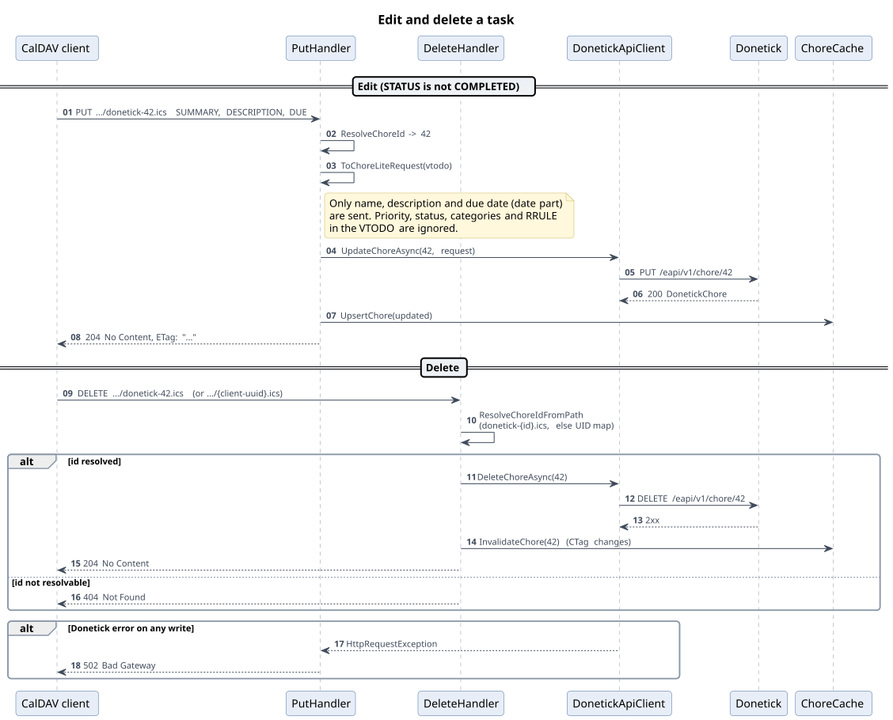

Source: [diagrams/seq-update-delete.puml](diagrams/seq-update-delete.puml)

DELETE resolves the ID from the path only (canonical name or client UUID through the UID map), calls `DELETE /eapi/v1/chore/{id}`, invalidates the cache entry and returns 204. An unresolvable path gives 404 without contacting Donetick.

## 11 VTODO mapping
### 11.1 Chore to VTODO
`VTodoMapper.ToIcsString` builds an Ical.Net `Todo`, wraps it in a `Calendar` with `PRODID:-//Donetick//CalDAV Bridge//EN` and serialises it with a new `CalendarSerializer` per call. A shared instance is not safe: its `SerializationContext` keeps a non-thread-safe object stack, and concurrent requests then fail with `NullReferenceException`. The ICS is generated on every request; it is not cached.

| Property | Value |
|----------|-------|
| `UID` | `donetick-{id}@donetick` |
| `SUMMARY` | `name` ("Untitled" when null) |
| `DESCRIPTION` | `description`, or empty |
| `DTSTAMP`, `LAST-MODIFIED` | `updatedAt` (UTC) |
| `CREATED` | `createdAt` (UTC) |
| `STATUS` | `StatusMapper.ToVTodoStatus(status, isActive)` |
| `PRIORITY` | `PriorityMapper.ToVTodoPriority(priority)` |
| `DUE`, `DTSTART` | see 11.2; omitted without `nextDueDate` |
| `CATEGORIES` | one value per non-empty label name |
| `X-APPLE-HASHTAGS` | non-empty label names joined with commas |
| `PERCENT-COMPLETE` | 50 when status is In progress |

The status and priority tables are in the functional design, BR-04 and BR-06.

### 11.2 Due date rules
1. Start from `nextDueDate`, treated as UTC.
2. If `PreserveScheduledTime`: `AdjustToScheduledTime` parses `frequencyMetadata.time` with `TimeOnly.TryParse`. With a resolvable `timezone` (`TimeZoneInfo.FindSystemTimeZoneById`), it converts to local time, replaces hour and minute (seconds zero) and converts back to UTC. Without a time zone, or when the zone is unknown, it replaces hour and minute in UTC. An empty or unparseable time leaves the value unchanged. Donetick 0.1.82 stores the time as an RFC3339 timestamp, which `TimeOnly.TryParse` rejects, so with current Donetick data the value is never adjusted (finding F-23).
3. If `AllDayEvents`: `DUE` and `DTSTART` become date-only values (`VALUE=DATE`, no time zone) built from the **UTC** year, month and day, using `new CalDateTime(DateOnly)`. Each property gets its own instance.
4. Otherwise: `DUE` is the UTC date-time; `DTSTART` is a date-only value (`VALUE=DATE`) of the UTC date. This is the shape Ical.Net 4 produced implicitly and that synced clients know; a unit test guards it. No `DURATION` is emitted next to `DUE`.

Time zone IDs are resolved by the runtime. The default `aspnet:10.0` image is a regular (non-chiseled, non-Alpine) Linux image with ICU and time zone data, so IANA IDs such as `Europe/Amsterdam` resolve (**Assumption** based on the published base image, not verified in this repository).

### 11.3 VTODO to write request
`VTodoMapper.ToChoreLiteRequest` produces:

| Field | Source |
|-------|--------|
| `name` | `SUMMARY` ("Untitled Task" when missing) |
| `description` | `DESCRIPTION`, null when empty or whitespace (then omitted from JSON) |
| `dueDate` | `DUE.AsDateTimeOffset` formatted `yyyy-MM-dd`, null when there is no `DUE` (then omitted) |

`STATUS` is evaluated separately by `StatusMapper.FromVTodoStatus`; only `ShouldComplete` is used. All other properties, including `PRIORITY`, `RRULE`, `CATEGORIES` and alarms, are ignored.

## 12 Virtual calendars
`CalendarResolver` implements GroupByLabel without any storage.

- **Assignment:** `GetSlugForChore` returns the slug of the single label, or `tasks` for zero or several labels. See the functional design, BR-01, and the diagram below.
- **Slug:** `ToSlug` applies Unicode normalisation form D, drops non-spacing marks, lower-cases, replaces spaces with dashes, removes everything outside `[a-z0-9-]`, collapses dashes and trims them. Empty becomes `label`. Collisions merge calendars, including with `tasks`.
- **Colour:** `GenerateColor` takes the first two bytes of SHA-256 of the label name as an unsigned 16-bit number, modulo 360, as hue; saturation 0.55, lightness 0.50; output `#RRGGBBFF`.
- **Calendar list:** the default calendar (always present, `DefaultCalendarName`, `CalendarColor`), then label calendars ordered by slug (ordinal, case-insensitive). The display name of a label calendar is the label name of its first chore.
- **Validity:** `tasks` is always valid; a label slug is valid while at least one chore maps to it.
- **Cost:** every call partitions the full chore list. For a single user with tens to hundreds of chores this is negligible.


Source: [diagrams/act-calendar-assignment.puml](diagrams/act-calendar-assignment.puml)

## 13 Donetick integration
### 13.1 Endpoints used

| Operation | Request | Response handling |
|-----------|---------|-------------------|
| List chores | `GET /eapi/v1/chore` | JSON array, or object `{"res": [...]}`; anything else throws `JsonException` |
| Create | `POST /eapi/v1/chore` with `ChoreLiteRequest` | `DonetickChore` (may be null) |
| Update | `PUT /eapi/v1/chore/{id}` with `ChoreLiteRequest` | `DonetickChore` (may be null) |
| Delete | `DELETE /eapi/v1/chore/{id}` | status only |
| Complete | `POST /eapi/v1/chore/{id}/complete` without body | status only |

Every call uses `EnsureSuccessStatusCode()`, so non-2xx responses surface as `HttpRequestException`. Authentication is the `secretkey` default request header. The eAPI offers no label, priority or recurrence management; this is the root of most functional limitations.

### 13.2 Resilience

| Setting | Value |
|---------|-------|
| Strategy | Polly retry via `AddResilienceHandler("donetick")` |
| Attempts | 3 retries after the initial attempt |
| Delays | 5 s, 15 s, 40 s (about 60 s, matching Apple's request timeout) |
| Triggers | `HttpRequestException`, HTTP status 500 and above |
| Methods | All, including POST |
| Timeout | `HttpClient.Timeout` 90 s for the whole call including retries |

On top of this, `ChoreSyncService` has its own three-attempt loop for the startup load.

## 14 Security
### 14.1 Authentication
- HTTP Basic against `CalDav:Username` and `CalDav:Password` from configuration.
- Comparison with `CryptographicOperations.FixedTimeEquals` on UTF-8 bytes, which removes per-byte timing leaks; the length of the credentials remains observable, as documented in the code.
- Anonymous: `/.well-known/caldav`, OPTIONS on `/caldav`, `/`, `/health`, `/health/json`.
- No rate limiting, lockout or audit logging of failed attempts (401s are logged at Debug).

### 14.2 Transport
- Built-in HTTPS with PEM or PFX, or TLS termination in front (Tailscale serve, reverse proxy). Without either, credentials travel in clear text.
- Certificates are loaded once at startup; renewal requires a restart.
- The connection to Donetick uses whatever scheme `Donetick:BaseUrl` specifies; the example uses HTTP inside the Docker network or tailnet.

### 14.3 Input handling
- PUT bodies limited to 1 MB; ICS parse errors contained.
- XML bodies of PROPFIND, REPORT and PROPPATCH are read with `ReadToEndAsync` without an explicit limit; Kestrel's default maximum request body size (about 30 MB) applies. These requests are only processed after authentication.
- XML is parsed with `XDocument.Parse`. On .NET no `XmlResolver` is configured by default, so external entities are not resolved; DTD processing is not explicitly disabled.
- Values shown on the status page (`BaseUrl`, `Username`, `CalendarName`, client display names) are HTML-encoded.

### 14.4 Information exposure
The anonymous status page and health endpoint reveal the version, the Donetick base URL, the CalDAV username, the calendar name, the poll interval and the types of connected clients. The endpoints are intended for use on a private network.

### 14.5 Secrets
- `Donetick__ApiKey` and `CalDav__Password` come from environment variables.
- `.gitignore` excludes `docker-compose.yml`, `appsettings.*.json`, `*.pfx` and `*.key`, so the local compose file with real values stays out of version control; `docker-compose.yml.example` holds placeholders.

## 15 Deployment and operations
### 15.1 Deployment view
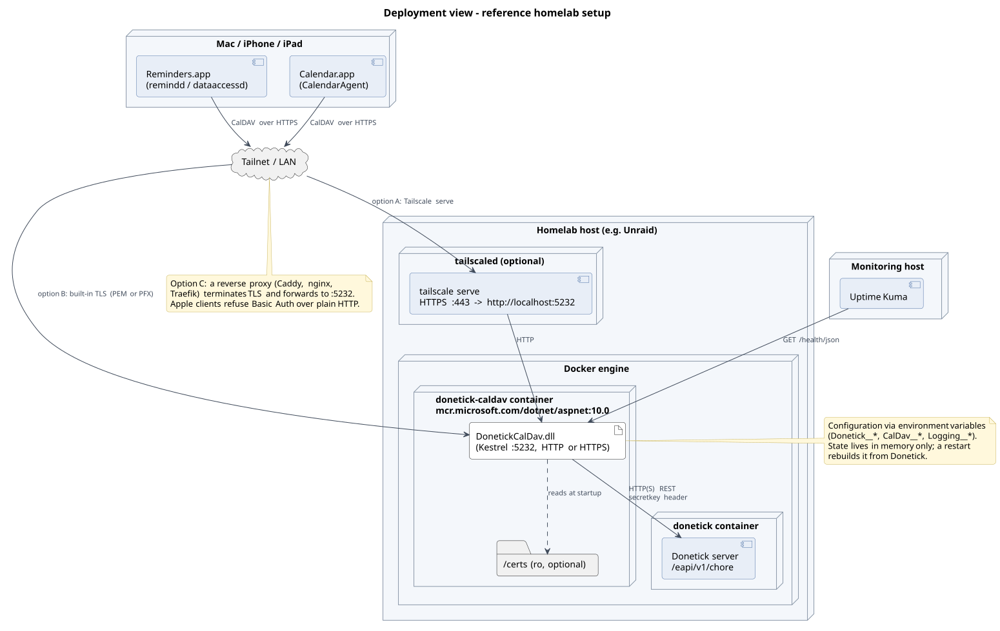

Source: [diagrams/deployment.puml](diagrams/deployment.puml)

### 15.2 Container image
Multi-stage `Dockerfile`: the SDK stage copies `src/DonetickCalDav/` and runs `dotnet publish -c Release`; the runtime stage copies the output into `aspnet:10.0`, exposes 5232 and starts `dotnet DonetickCalDav.dll`. There is no `USER` instruction (the process runs as root) and no `HEALTHCHECK`. Tests are not run during the image build.

### 15.3 Deployment options

| Option | Files | Notes |
|--------|-------|-------|
| Docker Compose | `docker-compose.yml.example` | Builds locally, maps 5232, log rotation 3 x 10 MB, `restart: unless-stopped` |
| Unraid | `unraid-template.xml` | All settings as template variables, `/certs` volume, WebUI on the status page; registry and support URLs are still placeholders |
| Plain `dotnet run` | `src/DonetickCalDav` | Needs the .NET 10 SDK |

TLS can be provided in three ways: `tailscale serve` in front of plain HTTP, built-in TLS with certificates mounted under `/certs`, or a reverse proxy.

### 15.4 Logging
- Categories under `DonetickCalDav` log business events (create, complete, delete, MOVE rejected, startup sync) at Information and protocol detail at Debug.
- Warnings: failed syncs, oversized bodies, parse failures, startup retries. Errors: Donetick unreachable after retries, unexpected exceptions.
- Structured properties use consistent names (`{Id}`, `{Path}`, `{Count}`, `{CTag}`, ...).
- `Logging__LogLevel__DonetickCalDav=Debug` enables verbose logging.

### 15.5 Monitoring
- `/health/json`: 200 when the cache contains at least one chore, otherwise 503. It does not reflect whether the last poll succeeded.
- `/` and `/health`: HTML dashboard with counts, uptime, configuration and clients seen in the last hour.
- `ClientTracker` groups requests by normalised User-Agent (Apple Calendar, Reminders, iOS, Thunderbird, Evolution, DAVx5, curl, wget, other), capped at 100 entries with least-recently-seen pruning.

## 16 Testing
### 16.1 Test suite
Three projects under `tests/`, all on xUnit v3 and Microsoft.Testing.Platform (opted in through `global.json`), with package versions in `tests/Directory.Packages.props`:

- `DonetickCalDav.Tests`: unit tests; references the application project (`InternalsVisibleTo` exposes internal members such as `AdjustToScheduledTime` and the `ChoreSyncService` timings).
- `DonetickCalDav.IntegrationTests`: the application hosted in-process with `WebApplicationFactory<Program>`, Donetick replaced by a WireMock.Net stub and the clock by a fake `TimeProvider` (testing strategy, 5.3).
- `DonetickCalDav.Testing`: shared helpers, no tests: `TestChoreFactory` and `ChoreMatrix`, `TestTimeProvider`, the integration harness (`BridgeHost`, `DonetickStub`, `CalDavClient`, `AppleRequests`, the replay session model) and the snapshot helper (`Snapshot`, `Scrubbers`).

Approved snapshots live in `Snapshots/` folders next to their test classes: the ICS matrix (SN-01) in the unit project, HTTP responses (SN-02 to SN-05) and replay transcripts (L3) in the integration project. Replay sessions and Donetick fixtures are under `tests/fixtures`.

The table lists the unit test classes.

| Area | Test class | Test methods |
|------|------------|--------------|
| VTODO mapping | `VTodoMapperTests` | 38 |
| Virtual calendars | `CalendarResolverTests` | 24 |
| Cache | `ChoreCacheTests` | 20 |
| Client tracking | `ClientTrackerTests` | 13 |
| Path parsing | `PathHelperTests` | 11 |
| Status mapping | `StatusMapperTests` | 10 |
| PUT handler | `PutHandlerTests` | 10 |
| XML reader | `DavXmlReaderTests` | 9 |
| XML writer | `DavXmlWriterTests` | 9 |
| Donetick client | `DonetickApiClientTests` | 6 |
| Priority mapping | `PriorityMapperTests` | 5 |
| GET handler | `GetHandlerTests` | 4 |
| DELETE handler | `DeleteHandlerTests` | 3 |
| Background sync timing | `ChoreSyncServiceTests` | 4 |

The counts are `[Fact]` and `[Theory]` attributes (166 in total); theories run more cases. Helpers: `TestChoreFactory` (named chore scenarios on a fixed base date, in `DonetickCalDav.Testing`) and `HttpContextHelper` (a `DefaultHttpContext` with readable response body).

### 16.2 Coverage gaps
The integration tests (scenarios IT-01 to IT-16 of the [testing strategy](testing-strategy.md)) cover the request pipeline, authentication, PROPFIND, REPORT, PROPPATCH, the status endpoints, the sync service and the startup validation. Together with the unit tests they cover 91.5 % of the hand-written lines; the least covered files are `Program.cs` (TLS certificate loading, 74 %) and `ClientTracker` (pruning, 74 %). Open findings are pinned by characterization tests with the trait `KnownIssue`. Container tests and contract tests against a real Donetick follow the roadmap.

`VTodoMapperTests.ToIcsString_ConcurrentCalls_DoNotThrow` serialises 20,000 chores in parallel and fails if a shared serializer is reintroduced.

## 17 Design decisions
The decisions below are recorded with their rationale in [../instructions.md](../instructions.md). They are summarised here so the technical picture is complete.

| Decision | Rationale | Trade-off |
|----------|-----------|-----------|
| In-memory cache only | Donetick is the source of truth; no migrations or backups | UID map lost on restart; cold start needs Donetick |
| Ephemeral UID map | Avoids a second source of truth | Short window where a client UUID can miss after restart |
| No RRULE | Apple's recurring VTODO handling is quirky; Donetick owns recurrence | Clients cannot show future occurrences |
| Virtual calendars per label | Apple ignores `CATEGORIES` and hashtags on CalDAV accounts | Two or more labels fall back to the default list |
| MOVE returns 403 | Delete plus create would strip metadata and history | Users get an error when dragging |
| Throw on unknown JSON shape | An empty list would look like data loss | Sync logs errors until the contract is fixed. In practice only non-object bodies throw; any JSON object reads as an empty list (finding F-26) |
| Constant-time credential check | Prevents byte-wise timing probes | Length still observable |
| Bounded `ClientTracker` | Prevents memory growth from rotating User-Agents | Oldest entries dropped |
| Single-source version | One place to bump | none |
| Validate options at startup | Fail fast instead of silent 401s | Host does not start on bad config |
| Full reload after completion | Server-side effects are unpredictable | Two Donetick calls per completion |
| No ETag after completion | Forces the client to refetch | One extra client request |
