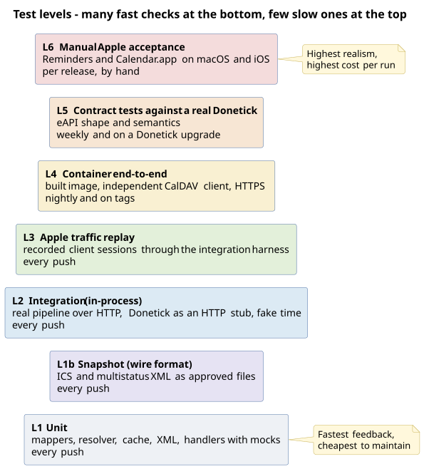
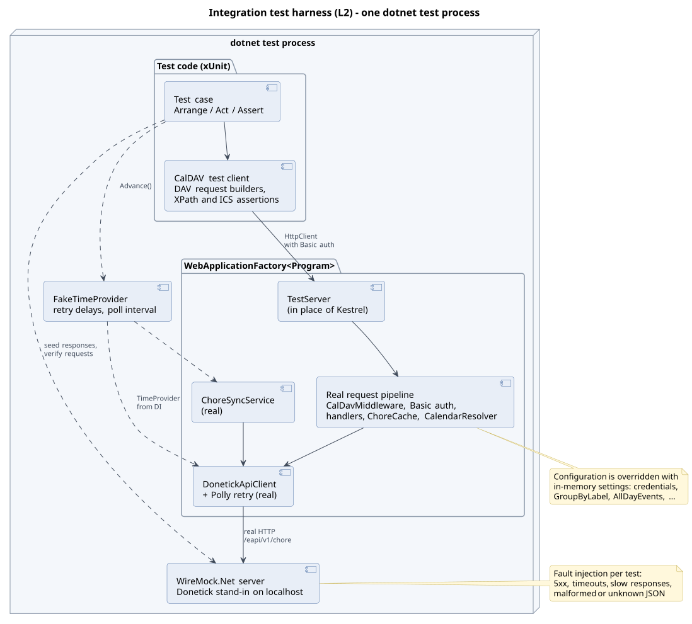
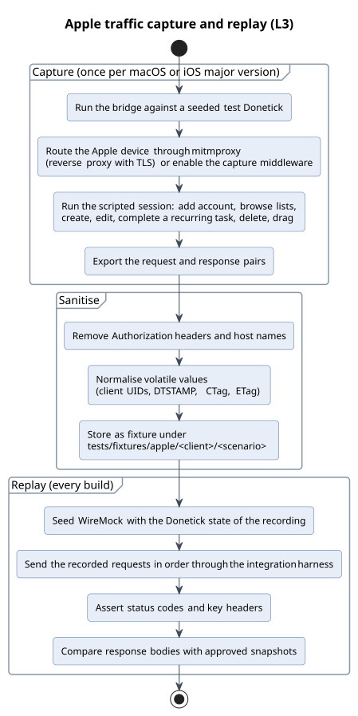
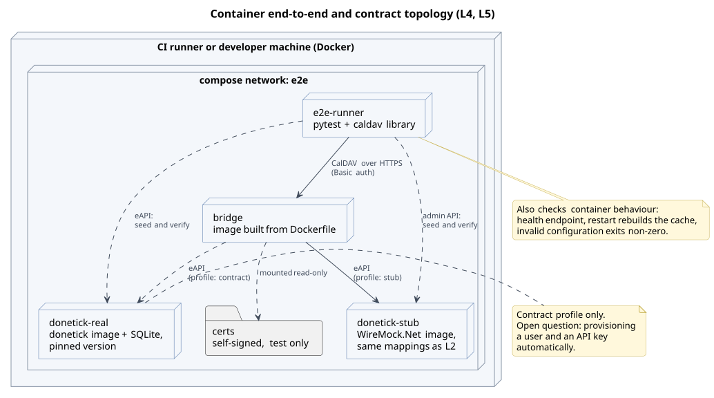
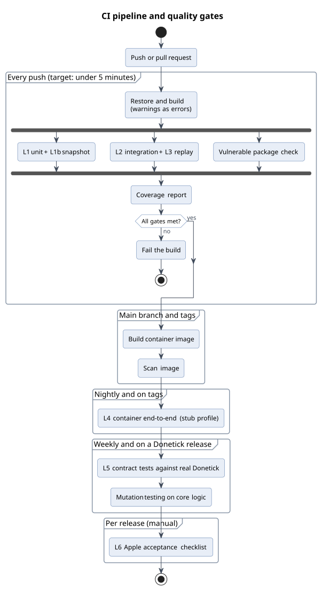

# Donetick CalDAV Bridge - Testing Strategy
Status: accepted on 2026-10-17, snapshot library decided on 2026-10-18; implementation not started. Applies to the code after the Ical.Net 5 upgrade (commit `0209644`).

## Summary
The bridge has a solid unit test suite (210 tests) but nothing that exercises the application as a whole. Measured line coverage of hand-written code is 44 %; the request pipeline, authentication, PROPFIND, REPORT, the sync service and the startup code have no coverage at all. The Ical.Net 5 upgrade showed what that costs: a changed `DTSTART` value type and a concurrency defect only surfaced through ad-hoc output comparison and stress runs.

This strategy adds five layers on top of the unit tests, chosen from a risk analysis rather than a template:

- **Snapshot tests** freeze the wire format Apple clients depend on (ICS and multistatus XML).
- **In-process integration tests** run the real pipeline over HTTP against a Donetick HTTP stub with controllable time. This is the layer with the highest return and comes first.
- **Apple traffic replay** turns recorded Reminders and Calendar.app sessions into repeatable tests.
- **Container end-to-end and contract tests** check the built image with an independent CalDAV client, and the assumptions about the Donetick API against a real Donetick.
- **A short manual Apple checklist** covers what cannot be automated ([testing/apple-acceptance.md](testing/apple-acceptance.md)).

The project is deliberately used as a reference case for practices that are meant to carry over to other work, so the strategy goes further than an application of this size strictly needs. Each layer states what it protects against, so layers can be dropped where a future project does not have that risk.

The key technical assumptions were checked with throwaway spikes before acceptance (appendix B): the integration harness works with this `Program.cs`, a fake clock skips the retry delays through the full CalDAV pipeline, a fresh Donetick can be provisioned over its REST API, and the snapshot library works on the chosen test stack. Snapshots use a small in-house helper of about 75 lines (prototype in appendix C) instead of a library: Verify now carries a maintenance fee for revenue-generating use, and the free alternatives are less complete (chapter 13).

Next step: phase 0 as specified in appendix A.

## 1 Purpose and scope
This document defines how the bridge is tested: which risks matter, which test levels address them, the tools, test data, conventions, the CI pipeline with its quality gates, and a phased roadmap.

It complements the [functional design](functional-design.md) (what to verify), the [technical design](technical-design.md) (what is built) and [findings.md](findings.md) (known defects, several of which become tests here). `instructions.md` refers to this document for the testing approach.

## 2 Current state

| Area | Tests today | Line coverage |
|------|-------------|---------------|
| VTODO mapping (`VTodoMapper`, `StatusMapper`, `PriorityMapper`) | Unit, thorough | 100 % |
| `ChoreCache`, `PathHelper`, `CalendarResolver` | Unit, thorough | 97 to 100 % |
| `PutHandler`, `GetHandler`, `DeleteHandler` | Unit, with mocked Donetick client | 84 to 100 % |
| `DavXmlWriter` / `DavXmlReader` | Unit | 98 % / 48 % |
| `DonetickApiClient` | Unit, with fake message handler | 54 % |
| `ClientTracker` | Unit | 72 % |
| `PropFindHandler`, `ReportHandler`, `PropPatchHandler` | none | 0 % |
| `CalDavMiddleware`, `CalDavAuthenticationHandler` | none | 0 % |
| `ChoreSyncService`, `StatusPageHandler`, `Program.cs` | none | 0 % |
| Container image, TLS, configuration via environment | none (manual) | n/a |
| Compatibility with Apple clients | manual, ad hoc | n/a |

Totals for hand-written code: 946 of 2,132 lines (44.4 %) and 308 of 779 branches (39.5 %), measured with coverlet on 2026-10-17. There is no CI; tests run when someone remembers.

Lessons from the Ical.Net 5 upgrade, each mapped to the layer that would have caught it:

| What happened | Caught by | Layer that catches it next time |
|---------------|-----------|---------------------------------|
| `DTSTART` changed from DATE to DATE-TIME | Manual comparison of 36 ICS outputs | Snapshot (L1b) |
| `DURATION` and `PRODID` changed | Same comparison | Snapshot (L1b) |
| Shared serializer failed under parallel load | Ad-hoc stress run | Unit and integration concurrency tests |
| JSON bodies are sent chunked (no `Content-Length`) | Hand-written mock failed | Integration against a real HTTP stub (L2) |

## 3 Principles
1. **Risk first.** Test effort follows impact and likelihood (chapter 4), not a coverage number.
2. **Test the contracts that matter.** The CalDAV wire format towards Apple and the requests towards Donetick are the two contracts; most assertions target them.
3. **Real where it is cheap, fake what we do not own.** Run the real ASP.NET Core pipeline, the real `HttpClient` and the real retry policy. Replace only Donetick, the Apple clients and the clock.
4. **Deterministic.** No wall clock, no sleeps, no internet, fixed test data. Time is controlled with `FakeTimeProvider`.
5. **Fast feedback.** Everything that runs on every push finishes within a few minutes; slower layers run on a schedule.
6. **Every defect gets a test** at the lowest level that reproduces it, written before the fix.
7. **Known defects are pinned.** Open findings get characterization tests that assert today's behaviour and are inverted when the finding is fixed.
8. **Tests are traceable.** Each test names the use case, business rule or finding it covers (chapter 11).

## 4 Risk analysis

| ID | Risk | Impact | Likelihood | Addressed by |
|----|------|--------|------------|--------------|
| R1 | A change in the ICS or XML output breaks already-synced Apple clients | High | Medium | L1b snapshot, L3 replay, L6 acceptance |
| R2 | Writes are duplicated or lost in Donetick (double completion, duplicate create) | High | Medium | L2 with fault injection, characterization tests for F-01 and F-02 |
| R3 | The Donetick eAPI changes shape or semantics | High | Medium on each Donetick upgrade | L5 contract tests, fixture-based unit tests |
| R4 | Wiring regressions: DI lifetimes, middleware order, options validation, auth exemptions | Medium | Medium | L2 |
| R5 | Concurrency defects | High | Low | Unit and L2 concurrency tests |
| R6 | Authentication bypass or information exposure | High | Low | L2 auth matrix, security scans |
| R7 | A dependency upgrade changes behaviour silently | Medium | High | Full suite with L1b and L3, vulnerability checks |
| R8 | Container or deployment misconfiguration (TLS, environment variables, ports) | Medium | Low | L4 |
| R9 | Retry and recovery behave differently than designed | Medium | Medium | L2 with `FakeTimeProvider`, L4 chaos scenario |
| R10 | Performance degrades with many chores or devices | Low | Low | Optional load test |

## 5 Test levels


Source: [diagrams/test-levels.puml](diagrams/test-levels.puml)

| Level | System under test | Replaced | Tooling | Runs | Duration |
|-------|-------------------|----------|---------|------|----------|
| L1 Unit | One class or function | Donetick client (NSubstitute), clock | xUnit v3, FluentAssertions, NSubstitute | Every push | Seconds |
| L1b Snapshot | Output of mappers and handlers | As L1 or L2 | In-house snapshot helper | Every push | Seconds |
| L2 Integration | Whole application in one process | Donetick (HTTP stub), clock | `WebApplicationFactory`, WireMock.Net, `FakeTimeProvider` | Every push | Seconds |
| L3 Replay | Whole application, driven by recorded Apple sessions | Donetick (HTTP stub) | L2 harness, recorded fixtures, snapshots | Every push | Seconds |
| L4 End-to-end | Built container image | Donetick (stub container) | Docker Compose, pytest, `caldav` library | Nightly, tags | Minutes |
| L5 Contract | The Donetick eAPI as used by the bridge | nothing | Real Donetick container, pytest | Weekly, Donetick upgrades | Minutes |
| L6 Acceptance | Bridge with real Apple clients | nothing | [Checklist](testing/apple-acceptance.md), optional AppleScript | Per release | 15 to 30 minutes |

### 5.1 L1 Unit
The existing suite stays the base and keeps its conventions (`MethodName_Scenario_ExpectedOutcome`, `TestChoreFactory`). It moves to xUnit v3 in phase 0. Additions:

| ID | Addition | Why |
|----|----------|-----|
| U-01 | Deserialization tests on recorded Donetick payloads (array and `{"res": [...]}` shapes, nulls, missing fields) | Today's tests use hand-written JSON; recorded payloads catch real-world shapes |
| U-02 | Property-based tests (FsCheck): `ToSlug` output only contains `[a-z0-9-]`, has no leading or trailing dash and is idempotent; `AdjustToScheduledTime` keeps the local date across DST changes | Covers input spaces that example tests miss |
| U-03 | `DavXmlReader` edge cases: chunked body, empty body, invalid XML | 48 % coverage, and finding F-07 |
| U-04 | `ClientTracker` pruning at the 100-entry cap | Untested branch |

Handlers that mostly assemble XML (`PropFindHandler`, `ReportHandler`) are tested at L2 rather than with unit tests, because their value lies in the request-to-response mapping.

### 5.2 L1b Snapshot tests
Snapshot tests store the output once as an approved file and fail on any difference. The developer then either fixes the code or approves the new output, which makes every change to the wire format a visible, reviewed decision. This directly supports the stop condition in `instructions.md` about not altering the VTODO shape unintentionally.

| ID | Snapshot | Notes |
|----|----------|-------|
| SN-01 | ICS for the chore matrix: every `TestChoreFactory` scenario plus edge cases, times `AllDayEvents` on and off, times `PreserveScheduledTime` on and off | Automates the 36-case comparison done by hand during the upgrade |
| SN-02 | PROPFIND responses per level (root, principal, home at depth 0 and 1, collection at depth 0 and 1, resource), with GroupByLabel off and on | Uses the L2 harness |
| SN-03 | REPORT responses: `calendar-query`, `calendar-multiget` (including an unknown href), `sync-collection` | Pins today's behaviour, including finding F-03 |
| SN-04 | Error responses: 401 headers, 403 and 405 with `Allow`, PROPPATCH 207 | |
| SN-05 | `/health/json` body | Uptime and version scrubbed |

Volatile values are scrubbed before comparison: the random global CTag, uptime and version. `DTSTAMP` needs no scrubbing because it derives from fixed test data. Snapshots are stored with their real extension (`.verified.ics`, `.verified.xml`), so they are readable in reviews; a mismatch writes a `.received` file and fails with a line diff in the test output. New or changed snapshots are approved locally with `SNAPSHOT_ACCEPT=1`, which is ignored on CI.

### 5.3 L2 Integration tests
The integration harness hosts the real application in the test process and replaces only Donetick and the clock.



Source: [diagrams/test-harness-integration.puml](diagrams/test-harness-integration.puml)

- **Host:** `WebApplicationFactory<Program>` with `TestServer`. Settings are passed with `UseSetting`; `ConfigureAppConfiguration` does not reach the values `Program.cs` reads before `Build()` (verified, appendix B).
- **Donetick:** a WireMock.Net server on a random local port. Because it is real HTTP, the test also covers JSON serialization, the `secretkey` header, chunked request bodies and the Polly retry pipeline. Mappings live as JSON files that L4 reuses.
- **Time:** the test registers a `FakeTimeProvider`, so it can advance through the 5, 15 and 40 second retry delays and the poll interval instantly. Polly picks up the registered `TimeProvider` without code changes (verified); `ChoreSyncService` needs a small change (chapter 9).
- **Client:** a small CalDAV test client with request builders (PROPFIND with depth and properties, REPORT bodies, VTODO bodies) and assertions on XML (XPath) and ICS.

Scenario catalogue:

| ID | Scenario | Key assertions | Covers |
|----|----------|----------------|--------|
| IT-01 | Discovery chain as Apple performs it | 301 from `.well-known`; OPTIONS and `.well-known` without auth; 401 carries `DAV` and `WWW-Authenticate`; principal and home hrefs | UC-01, FR-01 to FR-04 |
| IT-02 | Authentication matrix | Wrong user, wrong password, malformed Base64, other schemes: 401; status endpoints anonymous | FR-03, NFR-01, R6 |
| IT-03 | Calendar home and collections, GroupByLabel off and on | Calendar list, names, colours, order; CTag of a list stable when another list changes | UC-07, BR-01 to BR-03 |
| IT-04 | REPORT types | Query returns all list members; multiget returns requested hrefs; 400 on empty body; 501 on unknown report | FR-09 |
| IT-05 | GET and HEAD | ICS body and ETag; 304 on matching `If-None-Match`; 404 for unknown IDs; UUID path via UID map | FR-10, FR-16 |
| IT-06 | Create from a client UUID | Donetick receives the expected body; 201 with `Location` and `ETag`; follow-up PUT and DELETE on the UUID path reach the same chore | UC-03, FR-11, FR-16, BR-12, BR-13 |
| IT-07 | Edit | Donetick receives name, description and date-only due date; 204 with new ETag; cache updated | UC-04, FR-12, BR-12 |
| IT-08 | Complete, including Apple's extra completed copy | One POST to `/complete`, followed by a full reload; 204 without ETag; the extra copy causes no request to Donetick | UC-05, FR-13, FR-14, BR-14, BR-17 |
| IT-09 | Delete | DELETE reaches Donetick; CTag changes; 404 for an unresolvable path without a Donetick call | UC-06, FR-15 |
| IT-10 | Unsupported operations | MOVE, MKCALENDAR, MKCOL: 403 with `Allow`; other methods: 405; PROPPATCH: 207 with every property 404 | UC-08, UC-09, FR-17, FR-18 |
| IT-11 | Input limits | PUT over 1 MB: 413 with and without `Content-Length`; invalid ICS: 400 | FR-19, NFR-11 |
| IT-12 | Donetick faults | 5xx then success: retried and succeeds; persistent 5xx: 502 after three retries; unknown JSON shape during sync: previous cache kept | NFR-04, NFR-05, NFR-11, R9 |
| IT-13 | Startup | Donetick down at start, available later: cache filled on a later poll; missing API key or invalid URL: host fails to start | UC-10, UC-12, FR-20, FR-23 |
| IT-14 | Health and status | `/health/json` 503 with empty cache, 200 with chores; HTML page renders | UC-11 |
| IT-15 | Concurrency | Parallel GET, REPORT and PUT requests produce no errors and a consistent cache | R5 |
| IT-16 | Known issues (characterization) | F-01: completion succeeds but reload fails gives 502; F-02: POST is retried after a 5xx; F-13: health semantics | findings.md |

### 5.4 L3 Apple traffic replay
Apple clients cannot run in CI, but their traffic can. A session is recorded once per major macOS or iOS version, sanitised, stored as a fixture and replayed through the L2 harness on every build. This turns "tested with Apple" from a one-off observation into a regression test.



Source: [diagrams/test-apple-replay.puml](diagrams/test-apple-replay.puml)

| ID | Recorded session | Clients |
|----|------------------|---------|
| RP-01 | Account setup (discovery) | Reminders and Calendar.app on macOS; iOS |
| RP-02 | Initial sync and a steady-state refresh with and without changes | Same |
| RP-03 | Create in the default list and in a label list | Reminders on macOS and iOS |
| RP-04 | Edit title, notes and due date | Reminders on macOS |
| RP-05 | Complete a recurring task (the double PUT) | Reminders on macOS and iOS |
| RP-06 | Delete | Reminders on macOS |
| RP-07 | Drag between lists (MOVE) | Reminders on macOS |

Recording uses mitmproxy as a TLS reverse proxy in front of the bridge (`mitmproxy --mode reverse:http://<bridge>:5232`), with the mitmproxy CA trusted on the test device, and exports the flows. Sanitising removes `Authorization` headers and host names and normalises client-generated UIDs and tags. A capture middleware was rejected to keep test-only code out of production.

### 5.5 L4 Container end-to-end
L4 runs the image built from the `Dockerfile` in a Compose network with a Donetick stub and a test runner, so it covers what L2 cannot: the image itself, configuration through environment variables, TLS with a mounted certificate, and an independent CalDAV client.



Source: [diagrams/test-e2e-topology.puml](diagrams/test-e2e-topology.puml)

The runner uses pytest with the Python `caldav` library, a mature client that is independent of Apple. This catches places where the bridge only works because of Apple-specific behaviour. The stub is WireMock.Net in its container image, loading the same mapping files as L2.

| ID | Scenario |
|----|----------|
| E2E-01 | Discovery and calendar listing over HTTPS with Basic auth |
| E2E-02 | Fetch to-dos; fields match the seeded Donetick data |
| E2E-03 | Create a to-do; the stub received the expected request |
| E2E-04 | Edit a to-do |
| E2E-05 | Complete a to-do |
| E2E-06 | Delete a to-do |
| E2E-07 | GroupByLabel: one calendar per single label |
| E2E-08 | Invalid configuration: the container exits non-zero with a clear log line |
| E2E-09 | Restart: the cache is rebuilt and ETags are unchanged |
| E2E-10 | Health endpoint (and Docker `HEALTHCHECK` once finding F-18 is addressed) |
| E2E-11 | Chaos: stop the stub mid-run; reads keep working, writes return 502, service recovers when the stub returns |

### 5.6 L5 Contract tests against a real Donetick
The bridge relies on assumptions about the eAPI that no stub can verify. L5 runs the same Compose setup with a real Donetick container (`donetick/donetick`, pinned version, SQLite) and checks those assumptions directly against the API.

| ID | Check | Related |
|----|-------|---------|
| CT-01 | `GET /eapi/v1/chore` matches the recorded shape (JSON schema derived from fixtures) | R3, U-01 |
| CT-02 | Create with name, description and due date stores what was sent; what time Donetick assigns to a date-only due date | BR-12, L-08 |
| CT-03 | Completing a recurring chore advances `nextDueDate` and resets the status; what a completed one-off chore looks like | UC-05 |
| CT-04 | An update that omits `description` or `dueDate` keeps the old values | L-07 (assumption) |
| CT-05 | `updatedAt` changes when labels, priority or description change | F-04 (assumption) |
| CT-06 | Delete removes the chore from the list | UC-06 |
| CT-07 | Wrong `secretkey` is rejected | Security |

Provisioning a fresh Donetick needs no web UI. The flow below was derived from the Donetick source (commit `9d9921d`, 2026-10-16) and is confirmed in phase 4:

1. Start the container with `DT_ENV=selfhosted` and `DT_SQLITE_PATH`; it listens on port 2021 and offers `GET /api/v1/health` for readiness. Sign-up stays enabled unless `DONETICK_DISABLE_SIGNUP=true`.
2. `POST /api/v1/auth/` with `username` (4 to 20 characters, lowercase), `password` (8 to 64), `email` and optional `displayName` creates the user.
3. `POST /api/v1/auth/login` with username and password returns `access_token`.
4. `POST /api/v1/users/tokens` with `{"name": "..."}` and `Authorization: Bearer <access_token>` returns `{"res": {"token": "dt_..."}}`. That token is the `secretkey` for the eAPI.

The auth routes are rate limited, so the runner provisions once per run, not per test.

Consumer-driven contract tools such as Pact were considered. They need the provider to run verification, and Donetick is not under our control, so the fixture-plus-live-check approach is used instead.

### 5.7 L6 Manual Apple acceptance
A short checklist, run before each release on macOS and once on iOS: [testing/apple-acceptance.md](testing/apple-acceptance.md). Results are noted in the release entry of `CHANGELOG.md`. Reminders supports AppleScript, so the create, edit, complete and delete checks can be scripted on the Mac. Because the moment Apple syncs is not deterministic, such a script assists the manual check rather than replacing it.

### 5.8 Non-functional testing

| Area | Approach | When |
|------|----------|------|
| Security | Auth matrix in IT-02; `dotnet list package --vulnerable` in CI; image scan (for example Trivy); secret scanning (for example gitleaks) as a pre-commit hook, since the local `docker-compose.yml` holds a real API key | Every push and on main |
| Security, optional | OWASP ZAP baseline scan against the L4 container | Before release |
| Resilience | IT-12, IT-13 and E2E-11 | As per level |
| Performance, optional | NBomber scenario: 5 clients polling PROPFIND and REPORT every 15 s against 500 chores; initial target p95 below 100 ms with zero errors, to be calibrated after a first run | On demand |
| Test quality | Mutation testing with Stryker.NET on `CalDav/VTodo`, `CalendarResolver`, `PathHelper` and `ChoreCache`; initial target score set after the first run | Weekly |

### 5.9 Production checks
`/health/json` is designed for a monitor such as Uptime Kuma, but it only shows that the process runs and the cache is filled. A synthetic check adds an authenticated `PROPFIND` on the default calendar and looks for `getctag` in the response, for example a scheduled `curl` that reports to an Uptime Kuma push monitor. That proves authentication, routing and the cache work in the deployed instance.

## 6 Test data
- **Chore matrix:** `TestChoreFactory` grows into a builder plus a named matrix of scenarios, shared by L1, L1b and L2, all on the fixed base date it already uses.
- **Donetick fixtures:** sanitised payloads recorded from a real Donetick, stored under `tests/fixtures/donetick/`, used by U-01, WireMock mappings and CT-01.
- **WireMock mappings:** JSON files under `tests/fixtures/donetick/mappings/`, loaded by L2 and mounted into the L4 stub container.
- **Apple recordings:** under `tests/fixtures/apple/<client>/<scenario>/`, sanitised.
- **No personal data:** fixtures never contain real chore names, labels or credentials from the production Donetick.

## 7 Test doubles

| Double | Replaces | Levels | Notes |
|--------|----------|--------|-------|
| NSubstitute mock of `IDonetickApiClient` | Donetick client | L1 | Existing |
| Fake `HttpMessageHandler` | HTTP transport | L1 | Existing in `DonetickApiClientTests` |
| WireMock.Net server | Donetick over HTTP | L2, L3 | Fault injection, request verification, scenarios for stateful sequences |
| WireMock.Net container | Donetick over HTTP | L4 | Same mapping files as L2 |
| `FakeTimeProvider` | Clock and delays | L1, L2, L3 | From Microsoft.Extensions.TimeProvider.Testing |
| Recorded Apple sessions | Apple clients | L3 | |
| Real Donetick container | nothing | L5 | Pinned version |

## 8 Project structure and conventions

```text
global.json                           opts dotnet test into Microsoft.Testing.Platform
Directory.Packages.props              central package versions for all test projects
tests/
  DonetickCalDav.Tests/               L1 unit and L1b snapshot tests (existing project)
    Snapshots/                        approved snapshot files
  DonetickCalDav.IntegrationTests/    L2 and L3: WebApplicationFactory, WireMock.Net
  DonetickCalDav.Testing/             shared test helpers: snapshot helper, chore matrix
    Harness/                          host factory, CalDAV test client, assertions
  fixtures/
    donetick/                         recorded payloads and WireMock mappings
    apple/                            recorded Apple sessions
  e2e/
    docker-compose.e2e.yml            profiles: stub, contract
    test_*.py                         L4 and L5 scenarios
docs/testing/
  apple-acceptance.md                 L6 checklist
```

- **Naming:** unit tests keep `MethodName_Scenario_ExpectedOutcome`; integration tests use `Feature_Scenario_ExpectedOutcome`, for example `Complete_RecurringChore_ReloadsCacheAndOmitsETag`.
- **Traits:** `[Trait("Level", "Integration")]` for filtering, `[Trait("Covers", "UC-05")]` for traceability, `[Trait("KnownIssue", "F-01")]` for characterization tests. Under Microsoft.Testing.Platform the filter is `dotnet test --project <project> --filter-trait "Level=Integration"` (verified).
- **Snapshots:** approve locally with `SNAPSHOT_ACCEPT=1 dotnet test --project <project>`, then review the changed `.verified` files in the commit like any other code change.
- **Test IDs:** the IDs in this document (IT-08, SN-01, ...) appear in the test name or a trait, so the catalogue and the code can be cross-checked.
- **Flaky tests:** a flaky test is quarantined with a trait and a backlog item, and fixed or removed within a week. Automatic retries are not used, because they hide defects such as the serializer race.

## 9 Test seams in the code
Two small changes make the code testable without changing behaviour:

| Change | Why | Status |
|--------|-----|--------|
| Add `public partial class Program { }` at the end of `Program.cs` | `WebApplicationFactory<Program>` needs an accessible entry point type | Verified in a spike |
| Register `TimeProvider.System` and use it in `ChoreSyncService` for the startup delay, the startup retry back-off and the poll interval | Lets tests control the sync timing. Polly already uses a registered `TimeProvider`, so the HTTP retries need no change | Polly part verified; sync part to build |

A third seam was considered: resolving the `HttpClient` base address and API key from `IOptions<AppSettings>` instead of the setup-time snapshot. The spike showed that `UseSetting` already reaches those values, so this refactor is not needed for testing. It remains a small clean-up, because the startup log line also prints the snapshot value.

## 10 CI pipeline and quality gates
The repository is on GitHub, so GitHub Actions is the natural host. This also covers the CI idea in `backlog.md`.



Source: [diagrams/test-pipeline.puml](diagrams/test-pipeline.puml)

| Gate | Rule |
|------|------|
| Build | Zero warnings (`TreatWarningsAsErrors` in CI) |
| Tests | All L1, L1b, L2 and L3 tests pass; a snapshot mismatch fails the build |
| Coverage | Measured on every push with Microsoft.Testing.Extensions.CodeCoverage (Cobertura output). Gate: coverage of hand-written code may not drop below the value on `main` (ratchet), plus a floor of 80 % lines once phase 1 is done |
| Dependencies | No known vulnerable packages, including transitive ones |
| Image | No critical vulnerabilities in the container image |
| Release | L4 green on the release commit; L6 checklist done and noted in the changelog |

Test results are published as JUnit XML (`--report-xunit-junit`) so the GitHub Actions summary shows them. Coverlet's `coverlet.collector` is a VSTest data collector and does not apply once the projects run on Microsoft.Testing.Platform.

Coverage targets by area, as a check that every part of the code is exercised at the right level:

| Area | Target |
|------|--------|
| Mapping, cache, resolver, path parsing | Stay at 95 to 100 % (L1) |
| Handlers, middleware, authentication | 90 % or more (L2) |
| `ChoreSyncService`, `Program.cs` | Covered by L2 scenarios IT-12 and IT-13 |
| `StatusPageHandler` | Smoke coverage through IT-14 and SN-05 |
| Every use case | At least one L2 or L3 test |
| Every business rule | At least one L1 or L1b test |

## 11 Traceability
Use cases from the functional design mapped to tests. Unit test classes exist today; the other IDs are planned.

| Use case | L1 / L1b | L2 / L3 | L4 / L5 | L6 |
|----------|----------|---------|---------|----|
| UC-01 Connect account | | IT-01, IT-02, RP-01 | E2E-01 | AT-01 |
| UC-02 View tasks | `VTodoMapperTests`, SN-01, SN-02, SN-03 | IT-03, IT-04, IT-05, RP-02 | E2E-02 | AT-02 |
| UC-03 Create task | `PutHandlerTests` | IT-06, RP-03 | E2E-03, CT-02 | AT-03 |
| UC-04 Edit task | `PutHandlerTests`, `VTodoMapperTests` | IT-07, RP-04 | E2E-04, CT-04 | AT-04 |
| UC-05 Complete task | `PutHandlerTests`, `StatusMapperTests` | IT-08, RP-05 | E2E-05, CT-03 | AT-05 |
| UC-06 Delete task | `DeleteHandlerTests` | IT-09, RP-06 | E2E-06, CT-06 | AT-06 |
| UC-07 Browse per label | `CalendarResolverTests` | IT-03 | E2E-07 | AT-07 |
| UC-08 Move task (rejected) | | IT-10, RP-07 | | AT-08 |
| UC-09 Change list properties (rejected) | SN-04 | IT-10 | | AT-09 |
| UC-10 Configure and deploy | | IT-13 | E2E-08 | |
| UC-11 Monitor | SN-05 | IT-14 | E2E-10 | |
| UC-12 Synchronise cache | `ChoreCacheTests` | IT-12, IT-13 | E2E-09, E2E-11 | |

With the `Covers` trait in place, this table can be generated from the test assemblies instead of maintained by hand.

## 12 Roadmap

| Phase | Deliverables | Done when |
|-------|--------------|-----------|
| 0 Foundations | Specified in appendix A: xUnit v3 migration, Microsoft.Testing.Platform, central package versions, test seams, integration project skeleton | Unit tests green on v3; harness boots the app against WireMock in one passing test |
| 1 Integration | IT-01 to IT-16; WireMock mapping files; coverage report | All scenarios green; hand-written line coverage at least 80 % |
| 2 Wire format | Snapshot helper (P2-01); SN-01 to SN-05; first Apple recordings and RP-01 to RP-07 | Snapshots approved; replay green |
| 3 CI | GitHub Actions workflow with the gates from chapter 10; vulnerability and image scans | Pipeline required for merges to `main` |
| 4 Containers | L4 Compose setup with stub profile; E2E-01 to E2E-11; then L5 contract profile with automated provisioning | Nightly job green; contract checks documented |
| 5 Extras | U-01 to U-04, mutation testing, optional load and ZAP scans, synthetic PROPFIND check | Baselines recorded |

## 13 Decisions
Decided on 2026-10-17; the snapshot library on 2026-10-18.

| Topic | Decision |
|-------|----------|
| New test dependencies | Approved: Microsoft.AspNetCore.Mvc.Testing, WireMock.Net, Microsoft.Extensions.TimeProvider.Testing, xunit.v3. Optional tools (FsCheck, Stryker.NET, NBomber) are added when their phase starts |
| xUnit version | Move to `xunit.v3`: the new integration project starts on v3 and the unit project migrates in phase 0. This also requires Microsoft.Testing.Platform, because with the .NET 10 SDK `dotnet test` no longer runs VSTest for xunit v3, and a solution cannot mix both runners (verified) |
| L4 orchestration | pytest with Docker Compose: the CalDAV client is Python, and the setup is usable outside .NET |
| Real Donetick | Included as L5, with the provisioning flow from 5.6 |
| Recording Apple traffic | mitmproxy; no capture middleware in production code |
| Coverage gate | Ratchet plus an 80 % floor after phase 1 |
| `instructions.md` | Testing section updated to refer to this strategy |
| Snapshot library | No library: an in-house snapshot helper; see below |

Verify was the intended snapshot library. Since version 33 its build fails unless the project declares a sponsorship or an exemption (error SC021), and every Verify version released after 1 September 2026 falls under its maintenance fee. The fee applies to organisations with at least US$10,000 annual revenue that use the packages in revenue-generating work, starting at US$5 per month for fewer than 40 employees; open source projects without revenue are exempt.

Free alternatives were checked on 2026-10-18, each with a spike on xunit.v3 4.0.2 and Microsoft.Testing.Platform:

| Library | Licence | Maintenance | Result |
|---------|---------|-------------|--------|
| Verify.XunitV3 33.3.4 | MIT, maintenance fee for revenue-generating use | Very active (release 2026-10-16) | Works with the exemption declared. Keeps the `.ics` extension; a mismatch prints a line diff; built-in scrubbers and converters for XML, JSON and HTTP |
| Snapshooter.Xunit3 1.3.1 | MIT | Last release 2026-02-24 | Works. Stores raw text in `__snapshots__/*.snap`; a mismatch prints a character-level string diff and writes a `__mismatch__` file; creates missing snapshots silently unless strict mode is on; scrubbing of text is manual; oriented at JSON object snapshots |
| ApprovalTests 7.0.0 | Apache-2.0 | Last release 2025-07-03, last commit 2025-10-07 | Works. Keeps the extension; a mismatch only reports that the files differ, the diff comes from a local diff tool |
| Shouldly 4.3.0 (`ShouldMatchApproved`) | BSD-3-Clause | Active repository, last release 2025-01-23 | Works on its own. Failed with `MissingMethodException` next to a newer DiffEngine; adds a second assertion library next to FluentAssertions |
| In-house helper | n/a | Own code | Possible, but scrubbers, diff output and the approval workflow have to be built and maintained |

None of the free libraries matches Verify on output quality, scrubbing and maintenance at the same time. A prototype of an in-house helper (appendix C) delivered the parts this project needs in about 75 lines: approved files with the real extension, a `.received` file and a line diff on mismatch, scrubbers, line-ending normalisation, and bulk approval that is disabled on CI.

The decision is therefore an in-house helper (option C). It carries no licence obligations, so the pattern transfers to client work unchanged, and it can later move into a small internal package.

Accepted trade-offs:

- No automatic diff-tool launch; compare the `.received` and `.verified` files in the IDE.
- No ready-made converters; an XML normaliser and the scrubbers this project needs are added in phase 2.
- No detection of orphaned snapshot files.
- Line endings are normalised, so a CRLF regression in the ICS output needs its own assertion.

Verify remains the reference if these gaps start to hurt; for this repository the open source exemption would cover it.

## 14 Reusable pattern
The approach generalises to other services that sit between clients and a third-party API:

1. Start from a risk table, and derive the test levels from it.
2. Treat the outward wire format and the outbound API calls as contracts; snapshot the first, stub and verify the second.
3. Run the real application in-process with an HTTP stub for dependencies and a fake clock; this layer gives the most confidence per minute of run time.
4. Record real client traffic once and replay it on every build when the real client cannot run in CI.
5. Pin known defects with characterization tests, so the findings list and the test suite cannot drift apart.
6. Make tests traceable to requirements with traits, and generate the traceability matrix.
7. Tier the pipeline: fast layers on every push, containers nightly, live third parties weekly, humans per release.
8. Check licences of test tooling before adopting it; the Verify fee change shows that even test-only packages can carry obligations, and that a small in-house helper can be the better trade.

## Appendix A Phase 0 specification
Phase 0 prepares the repository so that phase 1 only adds tests. Each task is small enough for one commit.

| ID | Task | Acceptance criteria |
|----|------|---------------------|
| P0-01 | Add `global.json` with `{"test": {"runner": "Microsoft.Testing.Platform"}}` | `dotnet test --solution donetick_caldav.sln` runs on Microsoft.Testing.Platform |
| P0-02 | Add `Directory.Packages.props` (central package management) with the versions below; remove versions from the `.csproj` files | Both projects restore with identical package versions |
| P0-03 | Migrate `DonetickCalDav.Tests` to xUnit v3: replace `xunit` with `xunit.v3`, set `<OutputType>Exe</OutputType>`, keep `xunit.runner.visualstudio` for IDE discovery, fix the few API differences (`IAsyncLifetime` returns `ValueTask`, `Xunit.Abstractions` is gone) | All 210 tests pass, zero warnings |
| P0-04 | Test seam: `public partial class Program { }` | `WebApplicationFactory<Program>` compiles |
| P0-05 | Test seam: register `TimeProvider.System`; inject it into `ChoreSyncService` and use it for all delays | Existing behaviour unchanged; a unit test advances fake time through the startup retries |
| P0-06 | Create `tests/DonetickCalDav.IntegrationTests` with the harness: host factory (settings via `UseSetting`), WireMock server per test class, `FakeTimeProvider`, CalDAV test client with Basic auth | One smoke test (IT-01 discovery) passes |
| P0-07 | Update `instructions.md` (stack and testing sections) and the technical design chapter 16 when the projects change | Documentation matches the repository |

Phase 2 starts with one preparatory task:

| ID | Task | Acceptance criteria |
|----|------|---------------------|
| P2-01 | Add the snapshot helper from appendix C to `tests/DonetickCalDav.Testing`, extended with a discriminator for theories, an XML normaliser, scrubbers for CTag, uptime and version, and a `.gitattributes` entry `*.verified.* -text`; cover the helper with its own tests | SN-01 passes; helper tests cover new, match, mismatch, accept and CI cases |

Package versions to pin, checked on nuget.org and PyPI on 2026-10-17:

| Package | Version | Used by |
|---------|---------|---------|
| xunit.v3 | 4.0.2 | Both test projects |
| xunit.runner.visualstudio | 4.0.1 | Both test projects (IDE discovery) |
| Microsoft.NET.Test.Sdk | 18.11.0 | Both test projects |
| FluentAssertions | 7.2.2 | Both test projects (last Apache-2.0 version) |
| NSubstitute | 6.2.0 | Unit tests |
| Microsoft.AspNetCore.Mvc.Testing | 10.0.13 | Integration tests |
| WireMock.Net | 2.19.0 | Integration tests |
| Microsoft.Extensions.TimeProvider.Testing | 10.11.0 | Both test projects |
| Microsoft.Testing.Extensions.CodeCoverage | 18.12.0 | Both test projects (phase 3) |
| FsCheck.Xunit.v3 | 3.4.0 | Unit tests (phase 5) |
| dotnet-stryker (tool) | 5.0.0 | Phase 5 |
| NBomber | 6.7.1 | Phase 5, optional |
| caldav (Python) | 3.5.0 | L4 runner |
| pytest (Python) | 9.1.1 | L4 and L5 runner |
| donetick/donetick (image) | release v0.1.82 | L5; latest stable tag in the Donetick repository, image tag to confirm on Docker Hub |

## Appendix B Verified assumptions
Spikes run on 2026-10-17 in a scratch copy of the repository, with .NET SDK 10.0.112. None of this code is in the repository.

| Question | Result | How |
|----------|--------|-----|
| Does `WebApplicationFactory` with `ConfigureAppConfiguration` reach the Donetick base address read before `Build()`? | No. Requests went to `localhost:8080` from `appsettings.json` | Test against WireMock; the bridge's startup log also showed the old URL |
| Does `UseSetting` reach it? | Yes | Same test with `UseSetting` passed |
| Does a test-registered `FakeTimeProvider` control Polly's retry delays through the full CalDAV pipeline? | Yes. A PUT whose first Donetick call returned 500 completed after advancing fake time by 5 s, with two calls to the stub, in well under the real delay | `ConfigureTestServices` registered the fake; WireMock scenario returned 500 then 200 |
| Can xunit v3 4.x run under `dotnet test` with the .NET 10 SDK without changes? | No. It requires opting into Microsoft.Testing.Platform in `global.json`, and then every test project in the solution must use it | Build error on VSTest; the existing v2 project was rejected in MTP mode |
| How are tests filtered by trait under Microsoft.Testing.Platform? | `--filter-trait "Name=Value"`; JUnit, HTML and CTRF reports are built in | `dotnet test --help` on the spike project |
| Can Verify 33 be used without configuration? | No. Build error SC021 until a sponsorship or exemption is declared | Restore and build of `Verify.XunitV3` 33.3.4 |
| Does Verify 33 work on xunit.v3 4.x and Microsoft.Testing.Platform with the exemption declared? | Yes. The first run writes `.received.ics`; after approval the test passes; a changed `SUMMARY` fails with a line diff | Spike with `Directory.Build.props`, 2026-10-18 |
| Do the free alternatives work on the same stack? | Snapshooter, ApprovalTests and Shouldly all work; details and limitations in chapter 13 | Same spike, one test per library |
| Does an in-house helper cover this project's needs? | Yes, in about 75 lines: a new snapshot fails and writes a `.received` file; `SNAPSHOT_ACCEPT=1` approves it; an unchanged run passes; a changed `SUMMARY` fails with a line diff | Prototype in appendix C, 2026-10-18 |
| Can a fresh Donetick be provisioned without the web UI? | Yes, by the flow in 5.6 | Reading the Donetick source at commit `9d9921d`; to be confirmed against a container in phase 4 |

## Appendix C Snapshot helper prototype
The prototype used to decide on the in-house helper (chapter 13). It was tested on xunit.v3 4.0.2 with Microsoft.Testing.Platform and is the starting point for task P2-01; it is not yet in the repository.

Usage:

```csharp
Snapshot.Match(VTodoMapper.ToIcsString(chore), "ics", scrubbers: [Snapshot.ScrubGuids]);
```

Output on a mismatch:

```text
Snapshot mismatch for OwnTests.Ics.verified.ics:
  STATUS:NEEDS-ACTION
- SUMMARY:Shave
+ SUMMARY:Shave daily
  UID:donetick-42@donetick
```

Source:

```csharp
using System.Runtime.CompilerServices;
using System.Text;
using System.Text.RegularExpressions;

namespace Own;

/// <summary>
/// Minimal approval-style snapshot assertion: compares text with an approved
/// "{Class}.{Test}.verified.{ext}" file next to the test source.
/// </summary>
public static partial class Snapshot
{
    private const string AcceptVariable = "SNAPSHOT_ACCEPT";

    public static void Match(
        string actual,
        string extension = "txt",
        string? discriminator = null,
        IEnumerable<Func<string, string>>? scrubbers = null,
        [CallerFilePath] string sourceFile = "",
        [CallerMemberName] string testName = "")
    {
        var directory = Path.Combine(Path.GetDirectoryName(sourceFile)!, "Snapshots");
        var baseName = $"{Path.GetFileNameWithoutExtension(sourceFile)}.{testName}"
                       + (discriminator is null ? "" : $".{discriminator}");
        var verifiedPath = Path.Combine(directory, $"{baseName}.verified.{extension}");
        var receivedPath = Path.Combine(directory, $"{baseName}.received.{extension}");

        var received = Normalise(Scrub(actual, scrubbers));
        var verified = File.Exists(verifiedPath) ? Normalise(File.ReadAllText(verifiedPath)) : null;

        if (verified == received)
        {
            File.Delete(receivedPath);
            return;
        }

        Directory.CreateDirectory(directory);
        if (ShouldAccept())
        {
            File.WriteAllText(verifiedPath, received);
            File.Delete(receivedPath);
            return;
        }

        File.WriteAllText(receivedPath, received);
        var message = verified is null
            ? $"New snapshot, review {receivedPath} and rename it to {Path.GetFileName(verifiedPath)}."
            : $"Snapshot mismatch for {Path.GetFileName(verifiedPath)}:\n{LineDiff(verified, received)}";
        throw new Xunit.Sdk.XunitException(message);
    }

    /// <summary>Replaces GUIDs, which are random per run, with a stable token.</summary>
    public static string ScrubGuids(string text) => GuidPattern().Replace(text, "{guid}");

    private static string Scrub(string text, IEnumerable<Func<string, string>>? scrubbers) =>
        (scrubbers ?? []).Aggregate(text, (current, scrub) => scrub(current));

    // Line endings and a trailing newline would otherwise differ between Windows, macOS and git settings.
    private static string Normalise(string text) => text.Replace("\r\n", "\n").TrimEnd('\n') + "\n";

    // Never accept automatically on a CI server.
    private static bool ShouldAccept() =>
        Environment.GetEnvironmentVariable(AcceptVariable) == "1"
        && Environment.GetEnvironmentVariable("CI") is null;

    /// <summary>Line diff based on the longest common subsequence, with one line of context.</summary>
    private static string LineDiff(string expected, string actual)
    {
        var a = expected.Split('\n');
        var b = actual.Split('\n');
        var lcs = new int[a.Length + 1, b.Length + 1];
        for (var i = a.Length - 1; i >= 0; i--)
            for (var j = b.Length - 1; j >= 0; j--)
                lcs[i, j] = a[i] == b[j] ? lcs[i + 1, j + 1] + 1 : Math.Max(lcs[i + 1, j], lcs[i, j + 1]);

        var lines = new List<(char Kind, string Text)>();
        int x = 0, y = 0;
        while (x < a.Length || y < b.Length)
        {
            if (x < a.Length && y < b.Length && a[x] == b[y]) { lines.Add((' ', a[x])); x++; y++; }
            else if (x < a.Length && (y == b.Length || lcs[x + 1, y] >= lcs[x, y + 1])) lines.Add(('-', a[x++]));
            else lines.Add(('+', b[y++]));
        }

        var output = new StringBuilder();
        for (var i = 0; i < lines.Count; i++)
        {
            var nearChange = Enumerable.Range(Math.Max(0, i - 1), Math.Min(3, lines.Count - Math.Max(0, i - 1)))
                .Any(k => lines[k].Kind != ' ');
            if (nearChange) output.AppendLine($"{lines[i].Kind} {lines[i].Text}");
        }
        return output.ToString();
    }

    [GeneratedRegex("[0-9a-fA-F]{8}-?[0-9a-fA-F]{4}-?[0-9a-fA-F]{4}-?[0-9a-fA-F]{4}-?[0-9a-fA-F]{12}")]
    private static partial Regex GuidPattern();
}
```
